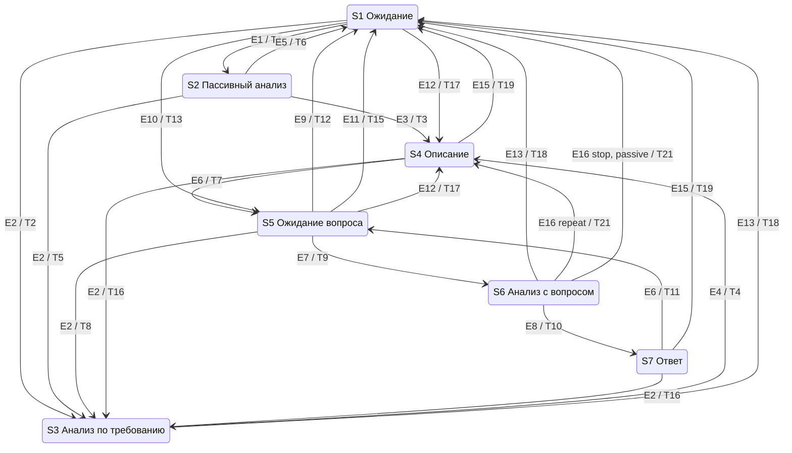
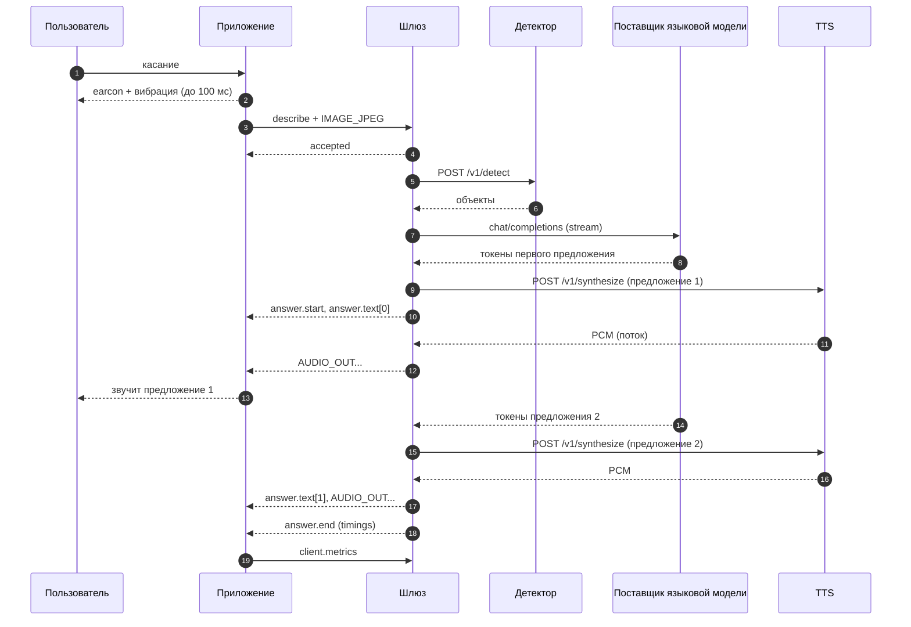

# assistant-low-vision-platform: спецификация

Выдержка из общей спецификации задачи `001-voice-scene-assistant` «Система голосового описания сцены для людей с нарушениями зрения: экспериментальный прототип». Источник - `docs/specs/001-voice-scene-assistant/spec.md` общего проекта: каталога, в котором рядом лежат `assistant-low-vision-platform`, `objects-detector`, `asr-service`, `tts-service` и `assistant-low-vision-mobile`. Вручную файл не правится: изменения вносятся в общую спецификацию и переносятся сюда.

Состав выдержки:
- общие разделы - без изменений, это общий контракт всех репозиториев: «Контекст и цели», «Глоссарий», «Сценарии использования», разделы требований 1-5 (SYS, NFR, CON, KM, PROTO) и «Принятые решения»;
- разделы требований этого репозитория: 7 (PLT), 8 (DSC), 12 (LLM), 14 (DEP) и 15 (EXP) целиком;
- критерии приёмки этого репозитория по таблице «Затрагиваемые модули» общей спецификации: AC-1 - AC-44, AC-104, AC-107 - AC-120, AC-126 - AC-131, AC-145, AC-147.

Команды критериев выполняются из корня этого репозитория: префикс `cd assistant-low-vision-platform &&` убран, пути внутри репозитория записаны от его корня, а соседние репозитории общего проекта - как `../<репозиторий>/`. Сквозные критерии (AC-1, AC-2, AC-3, AC-4 и AC-126) перенесены своей частью команды. Требования и критерии других модулей, на которые ссылается текст, - в общей спецификации.

Ключевые слова требований: **должен** - обязательно, проверяется критерием; **следует** - желательно, отказ обосновывается в `plan.md`; **может** - по желанию, критериев нет.

## Контекст и цели

- Зачем:
  - магистерская диссертация «Интеллектуальная система распознавания образов с голосовым сопровождением для людей с нарушениями зрения» (ГУАП, 09.04.01, группа 4542мк);
  - противоречие: точное описание сцены требует мощных моделей, которые увеличивают время ответа, а быстрые модели снижают качество описания;
  - проблема: неизвестно, какое сочетание и размещение моделей даёт голосовой ответ за приемлемое время без потери точности;
  - гипотеза, которую проверяет прототип: распределённое размещение сервисов и подбор моделей позволяют формировать голосовое описание сцены не более чем за 2000 мс (95-й перцентиль времени «касание → звук») при доле верно названных ключевых объектов не менее 75 % (объект засчитан, только если верно названы его класс и направление); при этом доля ответов, упрощённых из-за таймаута или отказа языковой модели (откатов на шаблон), не превышает 10 %, иначе время достигнуто за счёт отказа от модели. Гипотеза подтверждена, только если выполнены все три условия (EXP-8);
  - источники требований: `diploma/works/4542мк(НИР)КарповНИ.docx` (прецедент, концептуальная модель, архитектура), `diploma/works/КарповНИ(Содержание)4542мк.docx` (гипотеза, модели-кандидаты, метрики, методика), `diploma/works/4542мк(ЛР)КарповНИ-Задания.docx` (лабораторные 1-6), диаграммы `diploma/works/*.drawio`, решения автора от 2026-10-25 (раздел «Принятые решения»).
- Результат - открытый (Apache-2.0) экспериментальный прототип, который одновременно служит стендом для замеров:
  - мобильное приложение для Android, которым незрячий человек пользуется без опоры на зрение: касание - описание сцены, удержание - вопрос голосом, двойное касание - повтор, пассивный режим с предупреждением об опасности;
  - Шлюз на Go - единая точка входа: потоковый конвейер «снимок или вопрос → модели → голос», описание сцены, история диалога, журнал времени каждого этапа, конфигурация стенда;
  - сервисы ИИ-моделей с единым интерфейсом на Python: обнаружение объектов, распознавание речи, синтез речи - только в своём размещении;
  - языковая модель - облачный поставщик по OpenAI-совместимому API: Qwen через Polza.ai напрямую, GigaChat через прокси gpt2giga; своего сервера языковой модели нет;
  - развёртывание в двух вариантах: распределённый (эталонный) - облачная VM с доменом и своя машина моделей с видеокартой за NAT, связанные туннелем WireGuard, и вариант «всё своё на машине моделей», где VM - только TLS-прокси; защищённое соединение с приложением по домену с сертификатом Let's Encrypt;
  - инструменты эксперимента: задержка по этапам (медиана и 95-й перцентиль), доля верно названных ключевых объектов, повторные прогоны по набору данных для каждой конфигурации моделей с разбросом между прогонами, аналитическая оценка варианта «всё на устройстве».
- Граница задачи: эта задача даёт систему, экспериментальный стенд и инструменты эксперимента. Проведение эксперимента на наборе EXP-1, сравнение моделей и размещений и вердикт по гипотезе - задача `002-hypothesis-experiment`; она начинается после закрытия этой задачи и сбора набора (решение автора 2026-10-26).
- Главный принцип - скорость. Каждое решение оценивается по вкладу во время «касание → начало звучания ответа». Ответ идёт потоком: первое предложение уже звучит, пока модель дописывает следующее. Модели и поставщик языковой модели заменяются настройками, без изменения мобильного приложения, поэтому стенд сравнивает конфигурации на одной инфраструктуре.

## Глоссарий

| Термин | Значение |
|---|---|
| Приложение | мобильное приложение для Android (`assistant-low-vision-mobile`) |
| Шлюз | серверное приложение (`assistant-low-vision-platform`): единая точка входа, конвейер, история, журнал, описание сцены |
| Сервис ИИ-модели | HTTP-сервис над одной моделью в своём размещении: детектор (`objects-detector`), ASR (`asr-service`), TTS (`tts-service`); языковая модель к ним не относится - это внешний поставщик |
| Поставщик языковой модели | облачный сервис с OpenAI-совместимым API: Polza.ai (модели Qwen, подключение напрямую) или GigaChat (подключение через gpt2giga); своего сервера языковой модели нет |
| gpt2giga | официальный прокси для GigaChat: принимает OpenAI-совместимые запросы, сам получает и обновляет OAuth-токен GigaChat; отдельный контейнер рядом со Шлюзом, наружу не публикуется |
| VM | облачная виртуальная машина с доменом и публичным IP (не меньше 2 vCPU и 2 ГБ ОЗУ); в варианте B на ней Caddy (TLS), Шлюз, PostgreSQL и gpt2giga, в варианте A - только Caddy |
| Машина моделей | своя машина за NAT с видеокартой 8 ГБ, 8 ядрами CPU и 16 ГБ ОЗУ; в варианте B на ней детектор, ASR и TTS, в варианте A - все свои компоненты (Шлюз, PostgreSQL, gpt2giga, детектор, ASR, TTS) |
| Туннель | WireGuard между машиной моделей и VM; поднимает машина моделей, потому что она за NAT; порты машины моделей открыты только на адресе туннеля (и на `127.0.0.1` для отладки) |
| Вариант размещения | A - все свои компоненты на машине моделей, VM - только TLS-прокси через туннель; B (эталонный) - Шлюз, PostgreSQL и gpt2giga на VM, модели на машине моделей; C - «всё на устройстве», только аналитическая оценка |
| Эталонная конфигурация | вариант B на оборудовании VM и машины моделей (видеокарта машины моделей - «эталонная видеокарта»); поставщик, идентификаторы моделей, модель телефона и оборудование записываются в `deployments/reference.env` и README развёртывания перед замерами |
| Снимок | один кадр камеры в JPEG, длинная сторона по умолчанию 640 px |
| Сцена | снимок, найденные на нём объекты и текстовое описание (объект концептуальной модели) |
| Объект сцены | класс, название на русском, уверенность, рамка, направление, расстояние |
| Ключевой объект | объект ключевого класса (люди, двери, ступени, транспорт, препятствия); по ним считается метрика гипотезы: ключевой объект назван верно, только если в ответе верны и класс, и направление |
| Опасность | объект сцены, подпадающий под правило опасности уровня `danger` (класс, направление, расстояние, уверенность); правила уровня `notice` дают подсказки, а не предупреждения |
| Описание / ответ / предупреждение | 1-3 предложения о сцене / ответ на вопрос / короткая фраза об опасности |
| Запрос | одно обращение приложения: `describe` (по касанию или пассивное) или `ask` (вопрос); идентификатор - UUID, его создаёт приложение |
| Сессия | одно WebSocket-соединение приложения со Шлюзом; история диалога привязана к устройству, а не к соединению |
| Этап | измеряемый шаг конвейера (`detect`, `asr`, `llm_ttft` и т.д.), список - в PLT-14 |
| Касание → звук (E2E) | время от касания экрана (`MotionEvent.getEventTime` у `ACTION_DOWN`) до начала воспроизведения первого аудиофрагмента ответа |
| TTFA | серверная часть E2E: от получения Шлюзом полного входа до отправки первого аудиофрагмента |
| TTFT | время до первого токена языковой модели; у облачного поставщика - вместе с сетью до него |
| TTFB | время до первого байта ответа сервиса (для TTS - до первого аудиофрагмента) |
| RTF | коэффициент реального времени: время обработки / длительность аудио |
| Earcon | короткий (не длиннее 150 мс) звуковой сигнал-подтверждение действия |
| Режим описания | `template` (шаблоны без языковой модели), `llm` (объекты детектора + языковая модель), `vlm` (снимок прямо в мультимодальную модель облачного поставщика; только в экспериментах с согласием, по умолчанию - `llm`) |
| Конфигурация стенда, `config_id` | набор моделей и параметров всех сервисов и Шлюза, поставщик и модель языковой модели, вариант размещения; `config_id` - короткий хеш этого набора |
| Прогон | один полный проход набора данных через стенд на одной конфигурации; каждая конфигурация прогоняется не меньше трёх раз, потому что облачный поставщик не гарантирует детерминизм |
| p50 / p95 | медиана / 95-й перцентиль по выборке замеров |

## Сценарии использования

**UC-1. Описание по касанию** (прецедент из НИР). Пользователь заходит в незнакомую комнату и касается экрана. Приложение сразу подтверждает касание звуком и вибрацией, отправляет снимок, и не позже чем через 2 с звучит: «Вы в небольшой комнате. Слева стул и шкаф, впереди кровать.»

**UC-2. Вопрос и уточняющий диалог.** После описания микрофон включается на 5 с. Пользователь спрашивает: «В комнате есть люди?» - «Людей не вижу.» - «Где-то есть дверь?» - «Да, дверь справа, далеко.» Пользователь молчит 5 с - ассистент возвращается в ожидание. Вопрос можно задать и в любой момент, удерживая палец на экране.

**UC-3. Пассивный режим.** Пользователь идёт по улице с включённым пассивным режимом. Раз в 3 с приложение отправляет снимок. Если впереди близко автомобиль, ступени или столб, ассистент без участия пользователя говорит: «Осторожно, впереди близко ступени.» Если опасности нет, ассистент молчит. Одно и то же предупреждение не повторяется каждые 3 с.

**UC-4. Повтор.** Двойное касание или команда «повтори» - ассистент повторяет последний ответ без обращения к серверу.

**UC-5. Голосовые команды.** «Опиши», «что впереди», «повтори», «стоп», «включи (выключи) пассивный режим», остальное - свободный вопрос.

**UC-6. Отказы.** Нет сети, сервис недоступен или не ответил вовремя - пользователь слышит короткое понятное сообщение («Нет связи с сервером», «Не расслышал вопрос») и не остаётся в тишине.

**UC-7. Эксперимент.** Исследователь выбирает конфигурацию моделей, поставщика языковой модели и размещения (только настройками), несколько раз прогоняет набор снимков и вопросов через стенд и получает отчёт: время каждого этапа и всей цепочки (p50, p95) с разбросом между прогонами, доля верно названных ключевых объектов, доля выдуманных объектов, доля упрощённых ответов из-за отказов и задержек поставщика.

## Требования

### 1. Общесистемные функциональные требования (SYS)

- **SYS-1.** Система должна по касанию формировать голосовое описание сцены на русском языке: 1-3 предложения, сначала опасности, затем остальные объекты с направлением («слева», «впереди», «справа») и расстоянием («близко», «далеко»).
- **SYS-2.** Система должна отвечать на голосовые вопросы о сцене с учётом текущего снимка и истории: последних сцен, вопросов и ответов.
- **SYS-3.** Система должна в пассивном режиме анализировать снимок раз в 3 с и предупреждать об опасности без участия пользователя; без опасности - молчать.
- **SYS-4.** Приложение должно повторять последний ответ без обращения к серверу.
- **SYS-5.** Система должна распознавать голосовые команды из PLT-4 и отличать их от свободных вопросов.
- **SYS-6.** Модели, поставщик языковой модели и размещение должны заменяться только настройками сервисов, Шлюза и развёртывания, без изменения и пересборки приложения.
- **SYS-7.** Для каждого запроса должны фиксироваться время каждого этапа, время всей цепочки (в том числе измеренное на телефоне) и `config_id`.
- **SYS-8.** При отказе или таймауте любого сервиса пользователь должен в пределах дедлайна запроса услышать либо ответ (возможно упрощённый, PLT-9), либо понятное сообщение об ошибке.
- **SYS-9.** Всё взаимодействие с пользователем - на русском языке.

### 2. Нефункциональные требования (NFR)

**NFR-1. Время ответа.** Целевые значения на эталонной конфигурации (см. глоссарий и DEP-3); замер и вердикт проверяются в задаче `002-hypothesis-experiment`. Порог гипотезы - p95 строки «Описание по касанию, режим `llm`»; он засчитывается только вместе с порогами качества и доли откатов (NFR-3, вердикт EXP-8). «Телефон среднего класса» для замеров - конкретная модель, которая записывается в README развёртывания до начала замеров (модель, версия Android, объём ОЗУ).

| Сценарий | Что измеряется | p50 | p95 |
|---|---|---|---|
| Описание по касанию, режим `llm` | касание → звук | ≤ 1500 мс | ≤ 2000 мс |
| Описание по касанию, режим `template` | касание → звук | ≤ 800 мс | ≤ 1200 мс |
| Вопрос | конец вопроса (отпускание пальца или конец речи) → звук | ≤ 1500 мс | ≤ 2000 мс |
| Предупреждение в пассивном режиме | снимок сделан → звук | ≤ 600 мс | ≤ 1000 мс |
| Подтверждение жеста | жест распознан → звук или вибрация | - | ≤ 100 мс |

**NFR-2. Бюджет задержки по этапам.** Описание по касанию, режим `llm`, эталонная конфигурация (вариант B: Шлюз на VM, модели на машине моделей, языковая модель у облачного поставщика). Каждый компонент отвечает за свою строку; сумма p95 оставляет запас до 2000 мс:

| № | Этап | Где выполняется | p95, мс |
|---|---|---|---|
| 1 | касание (`ACTION_DOWN`) → жест распознан, снимок готов: кадр берётся из работающей камеры и кодируется в JPEG 640 px ещё пока палец на экране | телефон | 150 |
| 2 | передача снимка (около 50 КБ) по WSS до Шлюза | сеть: телефон → VM | 200 |
| 3 | Шлюз: приём, разбор, постановка в конвейер | VM | 5 |
| 4 | обнаружение объектов, включая HTTP через туннель | машина моделей, туннель | 80 |
| 5 | языковая модель: до первого токена, включая сеть от VM до поставщика | поставщик языковой модели, интернет | 700 |
| 6 | языковая модель: от первого токена до конца первого предложения | поставщик языковой модели | 250 |
| 7 | синтез первого предложения: до первого аудиофрагмента, включая туннель | машина моделей, туннель | 250 |
| 8 | доставка первого аудиофрагмента и начало воспроизведения | сеть: VM → телефон, телефон | 200 |
| | **сумма** | | **1835** |

- Запас до порога гипотезы - 165 мс. Строки 5 и 6 задаёт поставщик, управлять ими нельзя: они измеряются (LLM-4), и по ним выбираются поставщик и модель эталонной конфигурации.
- Путь с откатом на шаблон по таймауту первого токена (PLT-8, PLT-9) укладывается в порог сам: строки 1-4 (435 мс) + `APP_LLM_TTFT_TIMEOUT_MS` (900 мс) + шаблонное описание (до 5 мс) + строки 7-8 (450 мс) = 1790 мс.
- В сценарии «вопрос» обнаружение объектов идёт параллельно с речью пользователя и не лежит на критическом пути; вместо строк 1-4 стоят дозагрузка хвоста аудио (100 мс) и распознавание речи, включая туннель (250 мс): сумма 1750 мс.
- В пассивном режиме строк 5-6 нет: предупреждение строится по шаблону, его аудио обычно берётся из кэша TTS.
- Соответствие бюджету на эталонной конфигурации проверяется в задаче 002 (EXP-5).
- Бюджет задан для эталонного варианта B. В варианте A строки 4 и 7 идут без туннеля, зато снимок и аудио дважды проходят туннель (строки 2 и 8: телефон → VM → машина моделей и обратно), а к поставщику Шлюз обращается с машины моделей. Варианты сравниваются по замерам (EXP-5), а не по бюджету.

**NFR-3. Качество** (цели для выбора моделей; измеряются на собственном наборе по EXP-4; проверяется в задаче 002):
- доля верно названных ключевых объектов (верны класс и направление) - не менее 75 % (порог гипотезы); доля по одному классу, без направления, публикуется рядом, но порогом не является;
- доля названных, но отсутствующих на снимке объектов (выдуманных) - не более 10 %;
- доля откатов на шаблон в конфигурации режима `llm` (ответы с `degraded_reason` `llm_timeout` или `llm_unavailable`) - не более 10 % по объединению прогонов (порог гипотезы, EXP-8);
- WER распознавания вопросов - не более 15 % в тишине и не более 30 % при уличном шуме;
- синтез речи: не менее 90 % фраз верно поняты слушателями, MOS не ниже 3,5.

**NFR-4. Надёжность.** Цепочка деградации (PLT-9): пользователь слышит ответ или сообщение об ошибке не позже дедлайна запроса (по умолчанию 8 с). Падение одного сервиса не роняет Шлюз и другие сервисы. Недоступность базы данных не влияет на ответы пользователю.

**NFR-5. Нагрузка.** Следует выдерживать NFR-1 при 3 одновременных сессиях, в каждой - запрос по касанию раз в 5 с. Перегрузка обрабатывается отказом с кодом `busy` (Шлюз) или 503 (сервис), а не ростом очереди: устаревшая подсказка бесполезна. Проверяется в задаче 002.

**NFR-6. Телефон.** Приложение работает на Android 8.0+ (minSdk 26) с 3 ГБ ОЗУ. Трафик одного запроса по касанию - не более 100 КБ вверх; аудио ответа - PCM 16 бит (около 48 КБ/с при 24 кГц). Модели на телефоне не запускаются, кроме детектора речевой активности.

**NFR-7. Безопасность.**
- Приложение подключается к Шлюзу только по TLS 1.2+ (WSS) на домене с сертификатом Let's Encrypt, с токеном устройства.
- Сервисы ИИ-моделей, gpt2giga и база данных не публикуются в интернет; доступ к ним - только из сети Docker `alv-net` или через туннель, с токеном сервиса.
- Обращения к поставщику языковой модели - только по HTTPS с проверкой сертификата. Отключать проверку TLS запрещено и в Шлюзе, и в gpt2giga; для GigaChat доверенный корень - сертификат НУЦ Минцифры (Russian Trusted Root CA), смонтированный в контейнер gpt2giga.
- Секреты (`APP_LLM_API_KEY`, `GIGACHAT_CREDENTIALS`, токены устройств и сервисов, пароль базы данных, ключи WireGuard) берутся только из окружения или файла `.env`, который не попадает в git. Секретов нет в логах, ответах, журнале, снимке конфигурации и `/v1/config`. Ответ на внутреннюю ошибку обезличен.

**NFR-8. Приватность.**
- Снимки и записи вопросов не сохраняются никогда - ни на телефоне, ни на сервере: ни файлами, ни в базе, ни в логах. Они живут только в памяти на время запроса. Настройки, включающей их сохранение, нет. Набор данных для экспериментов собирается вне системы (EXP-1).
- Поставщику языковой модели уходит только то, что нужно для ответа. В режиме `llm` - только текст: объекты сцены, сводка истории, расшифровка вопроса. В режиме `vlm` - ещё и сам снимок, поэтому режим по умолчанию - `llm`, а `vlm` используется только в экспериментах: на снимках набора данных, собранных с согласием на передачу облачному поставщику, или с участниками, давшими информированное согласие (EXP-6).
- Идентификаторы устройства и участника (`device_id`, `label`) и `request_id` поставщику не передаются.
- Устройство идентифицируется псевдонимом (`device_id`, случайный UUID приложения); персональные данные не собираются.
- В логах нет изображений, аудио и токенов; расшифровки вопросов и тексты ответов - только на уровне DEBUG.

**NFR-9. Доступность** (ГОСТ Р 52872-2019, применимые требования):
- всё управление доступно без опоры на зрение: жесты на весь экран, подтверждение каждого действия звуком или вибрацией;
- приложение работает и с включённым TalkBack, и без него;
- для слабовидящих: крупный текст (не меньше 28 sp), контраст текста не ниже 7:1, состояние ассистента и последний ответ видны на экране.

**NFR-10. Сопровождаемость** (ГОСТ Р ИСО/МЭК 25010-2015):
- компоненты развёртываются и обновляются независимо;
- API версионированы (`/v1`, протокол `alv.v1`), контракты закреплены общими эталонными файлами (AC-1, AC-2);
- в каждом репозитории - тесты, README на русском, changelog;
- новый бэкенд модели добавляется классом в реестре, без правок API.

**NFR-11. Наблюдаемость.**
- Сквозной `request_id` (UUID запроса из приложения) передаётся во все свои сервисы (детектор, ASR, TTS) заголовком `X-Request-ID` и пишется в каждую строку лога о запросе. Поставщику языковой модели он не передаётся (NFR-8).
- Шлюз отдаёт метрики Prometheus (PLT-13); каждый сервис возвращает время своих этапов (SVC-5).

**NFR-12. Воспроизводимость.**
- Результат замера однозначно связан с `config_id`, тегами образов, `git_sha` сервисов и датой и временем прогона.
- `config_id` включает поставщика языковой модели (хост и путь `APP_LLM_URL`) и идентификатор модели (PLT-12). Журнал хранит для каждого запроса поле `model` из ответа поставщика и `system_fingerprint`, если поставщик его прислал (PLT-11).
- Параметры генерации фиксированы и передаются в каждом запросе: температура 0, seed 42 (DSC-5). Облачный поставщик детерминизм не гарантирует, поэтому каждая конфигурация прогоняется не меньше трёх раз (EXP-3). Отчёт показывает значения каждого прогона и разброс между ними; пороги NFR-1 и NFR-3 проверяются по объединению прогонов.
- Модель у поставщика может обновиться без предупреждения, поэтому дата и время каждого прогона записываются, а сравниваемые конфигурации следует прогонять в одни и те же дни.

**NFR-13. Лицензии.** Код всех репозиториев - Apache-2.0. Лицензии моделей и библиотек перечислены в README каждого сервиса таблицей «Модель | Лицензия | Коммерческое использование». Бэкенды под AGPL и GPL и модели с некоммерческой лицензией подключаются только как необязательные extras: без них сервис устанавливается и проходит быстрые тесты. Лицензия gpt2giga (MIT) и ссылки на условия поставщиков языковой модели указываются в README развёртывания.

### 3. Ограничения (CON)

- **CON-1. Репозитории и языки.**

  | Репозиторий | Компонент | Язык и основа |
  |---|---|---|
  | `assistant-low-vision-platform` | Шлюз, описание сцены, инструменты эксперимента, развёртывание всей системы | Go 1.24, стиль `ainergy-go-style` |
  | `objects-detector` | сервис обнаружения объектов | Python 3.12, FastAPI, стиль `ainergy-python-style` (`--ml`) |
  | `asr-service` | сервис распознавания речи | Python 3.12, FastAPI, стиль `ainergy-python-style` (`--ml`) |
  | `tts-service` | сервис синтеза речи | Python 3.12, FastAPI, стиль `ainergy-python-style` (`--ml`) |
  | `assistant-low-vision-mobile` | приложение | Kotlin, Android, Gradle Kotlin DSL |
  | - | языковая модель | облачный поставщик по OpenAI-совместимому API: Polza.ai напрямую, GigaChat через готовый образ прокси gpt2giga; своего кода нет, конфигурация - в `assistant-low-vision-platform/deployments` |

- **CON-2. Стиль кода.** Go - по скиллу `ainergy-go-style`, Python - по `ainergy-python-style`. Отступления ради открытого кода (подтверждены автором 2026-10-25):
  - Go-каркас скилла импортирует приватный `gitlab.itglobal.com/ainergy/platform/gopkg/logger` и генерирует модуль `gitlab.itglobal.com/...`, ClickHouse и GitLab CI. Приватные зависимости каркаса заменяются: логгер - собственным пакетом `internal/logger`, который пишется в проекте с тем же printf-API; модуль - `github.com/nikarpoff/<репозиторий>`; ClickHouse, GitLab CI, Harbor и S3 - по пунктам ниже;
  - вместо ClickHouse - PostgreSQL (как на диаграмме развёртывания ВКР), драйвер `pgx`; обёртка соединения под интерфейсом для моков сохраняется;
  - вместо GitLab CI, Harbor и S3 - GitHub Actions и GitHub Container Registry (`ghcr.io/nikarpoff/<репозиторий>`);
  - сеть Docker - `alv-net`;
  - миграции схемы БД лежат в репозитории Шлюза;
  - ни одной зависимости из закрытых реестров: каждый репозиторий собирается из открытых источников.
- **CON-3. Архитектура из ВКР.** Клиент-сервер, сервис-ориентированный стиль. Приложение - по шаблону MVC, Шлюз - по шаблону API Gateway. Концептуальная модель по Шлееру - Меллору (раздел KM) нормативна для приложения.
- **CON-4. Размещение моделей.**
  - Языковая модель - только облачные поставщики по OpenAI-совместимому API: Qwen через Polza.ai (напрямую) и GigaChat через прокси gpt2giga (LLM-1). Собственного сервера языковой модели нет, в том числе как базовой линии для сравнения.
  - Детектор, ASR и TTS - только своё размещение (машина моделей, DEP-3); облачные API для них не используются.

### 4. Концептуальная модель (KM)

**KM-1. Структура.** Объекты, атрибуты и связи из НИР, с отображением на реализацию:

| Объект КМ | Атрибуты | В приложении (Model) | В Шлюзе |
|---|---|---|---|
| Пользователь | в НИР атрибутов нет; общается с ассистентом и управляет им | устройство: `device_id`, настройки (адрес сервера, токен, пассивный режим) | `device` в журнале |
| Ассистент | текущая сцена; недавние сцены, вопросы и ответы | автомат состояний KM-2, последний ответ (текст и аудио) | история устройства (PLT-10) |
| Сцена | снимок, список объектов, текстовое описание | последняя сцена: объекты из `answer.end`, текст | запрос в журнале: объекты, описание, этапы |
| Объект сцены | название, занимаемая область, текстовое описание | элемент `objects` из `answer.end` | объект ответа детектора (DET-1) |

Связи: пользователь общается с ассистентом; ассистент получает текущую сцену и хранит несколько предыдущих; сцена содержит несколько объектов.

**KM-2. Автомат состояний ассистента** (нормативен для приложения). Состояния, события, переходы и действия НИР сохраняют номера; расширения для жестов из лабораторной 5 и обработки отказов имеют номера начиная с E10, T13, A9.

Состояния:

| Состояние | Смысл | Действия в состоянии |
|---|---|---|
| S1 | исходное: ожидание; при включённом пассивном режиме работает таймер 3 с | - |
| S2 | пассивный анализ среды | A2 |
| S3 | анализ по требованию пользователя | A3 |
| S4 | голосовое описание сцены (или предупреждение, или повтор) | A5 |
| S5 | ожидание вопроса: микрофон включён; окно 5 с до начала речи, или запись, пока палец удерживается | A6 при входе |
| S6 | анализ среды с учётом вопроса | A7 |
| S7 | ответ на вопрос | A5 |

События:

| Событие | Источник | Смысл |
|---|---|---|
| E1 | таймер | прошло 3 с в S1 при включённом пассивном режиме |
| E2 | пользователь | касание |
| E3 | Шлюз | пассивный анализ нашёл опасность (`answer.start` с `kind=warning`) |
| E4 | Шлюз | анализ по требованию готов (`answer.start`) |
| E5 | Шлюз | пассивный анализ без опасности (`passive.clear`) |
| E6 | приложение | воспроизведение ответа завершено |
| E7 | пользователь | вопрос задан: детектор речи отметил конец речи, или палец отпущен после речи длиннее 300 мс |
| E8 | Шлюз | ответ на вопрос готов (`answer.start`) |
| E9 | таймер | 5 с в S5 без начала речи |
| E10 | пользователь | удержание началось (касание дольше 400 мс) |
| E11 | пользователь | удержание закончилось без речи (короче 300 мс или тишина) |
| E12 | пользователь | двойное касание |
| E13 | сеть или Шлюз | ошибка: нет соединения, `error`, превышен дедлайн |
| E14 | пользователь | свайп вверх: переключить пассивный режим |
| E15 | пользователь | свайп вниз или команда «стоп»: прервать речь |
| E16 | Шлюз | команда, которую выполняет приложение (`transcript` с `intent` = `repeat`, `stop`, `passive_on`, `passive_off`) |

Переходы (T1-T12 - из НИР):

| Переход | Из | Событие | В | Действия |
|---|---|---|---|---|
| T1 | S1 | E1 | S2 | A1 |
| T2 | S1 | E2 | S3 | A13, A1 |
| T3 | S2 | E3 | S4 | A4 (на сервере) |
| T4 | S3 | E4 | S4 | A4 (на сервере) |
| T5 | S2 | E2 | S3 | A13, отмена пассивного запроса, A1 |
| T6 | S2 | E5 | S1 | - |
| T7 | S4 | E6 | S5 | A6 |
| T8 | S5 | E2 | S3 | A13, A8, A1 |
| T9 | S5 | E7 | S6 | A8, A1 (снимок сделан в начале речи) |
| T10 | S6 | E8 | S7 | A4 (на сервере) |
| T11 | S7 | E6 | S5 | A6 |
| T12 | S5 | E9 | S1 | A8 |
| T13 | S1 | E10 | S5 | A13, A6 в режиме удержания |
| T14 | S5 | E10 | S5 | A13, запись в режиме удержания |
| T15 | S5 | E11 | S1 | A13, A8 |
| T16 | S3, S4, S6, S7 | E2 | S3 | A13, A9, A1 |
| T17 | S1, S5 | E12 | S4 | A13, A8 (если из S5), A10 |
| T18 | S2, S3, S4, S6, S7 | E13 | S1 | A11 |
| T19 | S4, S7 | E15 | S1 | A13, A9 |
| T20 | S1, S2 | E14 | S1 | A13, отмена пассивного запроса (если из S2), A12 |
| T21 | S6 | E16 | S1 или S4 | `repeat` - A10 и S4; `stop` - S1; `passive_on`/`passive_off` - A12 и S1 |

Действия:

| Действие | Смысл |
|---|---|
| A1 | фотографирование: взять последний кадр работающей камеры, отправить на Шлюз |
| A2 | поиск опасностей (на Шлюзе) |
| A3 | общий анализ сцены (на Шлюзе) |
| A4 | составление описания (на Шлюзе) |
| A5 | озвучивание описания: воспроизведение потока аудио |
| A6 | включение микрофона |
| A7 | анализ среды с учётом вопроса (на Шлюзе) |
| A8 | выключение микрофона |
| A9 | прервать воспроизведение и отменить текущий запрос (`cancel`) |
| A10 | повтор последнего ответа из памяти приложения |
| A11 | сообщить об ошибке: earcon ошибки и короткая фраза по коду (PROTO-11) |
| A12 | переключить пассивный режим и озвучить новое состояние |
| A13 | подтверждение жеста звуком и/или вибрацией не позже 100 мс |

Не описанные в таблице пары «состояние - событие» игнорируются (жест подтверждается коротким сигналом «недоступно»). Пассивный режим работает только в S1: снимки в других состояниях не отправляются.



### 5. Протокол «приложение - Шлюз» (PROTO)

- **PROTO-1. Транспорт.** WebSocket поверх TLS: `wss://<хост>/v1/session`, подпротокол `alv.v1` (`Sec-WebSocket-Protocol`). Одно долгоживущее соединение на приложение: открывается при запуске и держится, пока приложение на экране. Сжатие `permessage-deflate` выключено: JPEG и PCM не сжимаются, а сжатие добавляет задержку.
- **PROTO-2. Аутентификация.** Токен устройства в заголовке `Authorization: Bearer <токен>` при открытии соединения. Нет токена или он неверный - HTTP 401 до установления WebSocket. Список токенов - настройка Шлюза (`APP_DEVICE_TOKENS`); работа без токенов допускается только при `APP_AUTH_DISABLED=true` (для разработки).
- **PROTO-3. Кадры.** Текстовые кадры - JSON в UTF-8 с обязательным полем `type`, имена полей в snake_case. Бинарные кадры - заголовок 22 байта и полезная нагрузка:

  | Смещение | Размер | Поле | Значение |
  |---|---|---|---|
  | 0 | 1 | `version` | `0x01` |
  | 1 | 1 | `kind` | `0x01` IMAGE_JPEG (приложение → Шлюз), `0x02` AUDIO_IN (приложение → Шлюз), `0x81` AUDIO_OUT (Шлюз → приложение) |
  | 2 | 16 | `request_id` | UUID запроса, 16 байт в сетевом порядке (RFC 4122) |
  | 18 | 4 | `seq` | номер фрагмента в запросе, uint32 big-endian, с 0 |
  | 22 | N | `payload` | IMAGE_JPEG - JPEG целиком одним кадром; AUDIO_IN - PCM s16le моно 16 кГц; AUDIO_OUT - PCM s16le моно с частотой из `answer.start` |

  - Неизвестная версия или `kind`, заголовок короче 22 байт - сообщение `error` с кодом `bad_request`, соединение не закрывается.
  - Снимок больше `APP_MAX_IMAGE_BYTES` (по умолчанию 2 МиБ), фрагмент аудио больше 64 КиБ, вопрос длиннее `max_question_ms` - `error` с кодом `payload_too_large`.
  - Эталонный вектор: `kind=0x01`, `request_id=123e4567-e89b-12d3-a456-426614174000`, `seq=0`, payload `FF D8 FF` → `01 01 12 3e 45 67 e8 9b 12 d3 a4 56 42 66 14 17 40 00 00 00 00 00 ff d8 ff`. Вектора кодирования для всех трёх `kind` и для ошибочных заголовков лежат одним файлом в репозиториях Шлюза и приложения, файлы побайтно совпадают (AC-2).

- **PROTO-4. Сообщения приложения.**

  | `type` | Когда | Поля |
  |---|---|---|
  | `hello` | первое сообщение после открытия соединения | `protocol` (1), `device_id`, `app_version`, `locale` (`ru-RU`), `platform` (`android-<API>`), `network` (`wifi`, `cellular`, `other`), необязательный `label` (код участника испытаний, EXP-6) |
  | `describe` | касание или таймер пассивного режима; сразу за ним - кадр IMAGE_JPEG с тем же `request_id` | `request_id`, `mode` (`on_demand`, `passive`), `focus` (`all`, `ahead`), `image` (`width`, `height`, `bytes`) |
  | `ask.start` | начало вопроса; затем необязательный кадр IMAGE_JPEG и кадры AUDIO_IN | `request_id`, `trigger` (`hold`, `listen_window`), `with_image` (bool) |
  | `ask.end` | конец вопроса | `request_id`, `audio_ms` |
  | `cancel` | пользователь прервал ответ или начал новый запрос | `request_id` |
  | `client.metrics` | после воспроизведения ответа или ошибки | `request_id`, `metrics` (`capture_ms`, `encode_ms`, `trigger_to_send_ms`, `trigger_to_accepted_ms`, `trigger_to_first_audio_ms`, `playback_underruns`; смысл - PLT-14), `network` |

  ```json
  {"type":"hello","protocol":1,"device_id":"5f0c3a52-8a0b-4d4e-9c61-3f1d2b7a9e10","app_version":"0.1.0","locale":"ru-RU","platform":"android-34","network":"wifi"}
  {"type":"describe","request_id":"123e4567-e89b-12d3-a456-426614174000","mode":"on_demand","focus":"all","image":{"width":640,"height":480,"bytes":48213}}
  {"type":"ask.start","request_id":"0b6a9a3e-4f7e-4b0e-8f0a-1c2d3e4f5a6b","trigger":"listen_window","with_image":true}
  {"type":"ask.end","request_id":"0b6a9a3e-4f7e-4b0e-8f0a-1c2d3e4f5a6b","audio_ms":1830}
  {"type":"client.metrics","request_id":"123e4567-e89b-12d3-a456-426614174000","metrics":{"capture_ms":34,"encode_ms":21,"trigger_to_send_ms":71,"trigger_to_accepted_ms":158,"trigger_to_first_audio_ms":1240,"playback_underruns":0},"network":"wifi"}
  ```

- **PROTO-5. Сообщения Шлюза.**

  | `type` | Когда | Поля |
  |---|---|---|
  | `welcome` | ответ на `hello` | `session_id`, `server_version`, `config_id`, `config`: `image_max_side`, `jpeg_quality`, `passive_interval_ms`, `listen_window_ms`, `max_question_ms`, `audio_in`, `audio_out` (`format`, `sample_rate`, `channels`) |
  | `accepted` | вход получен полностью: снимок (для `describe`) или `ask.end` | `request_id` |
  | `transcript` | вопрос распознан | `request_id`, `text`, `intent` (PLT-4) |
  | `answer.start` | начинается ответ | `request_id`, `kind` (`description`, `answer`, `warning`), `priority` (`normal`, `high`), `audio` (формат или `null`, если звука не будет) |
  | `answer.text` | перед аудио каждого предложения | `request_id`, `seq` (номер предложения с 0), `text` |
  | `answer.end` | ответ закончен | `request_id`, `text` (полный), `intent`, `hazard`, `degraded`, `degraded_reason` (`llm_timeout`, `llm_unavailable`, `tts_unavailable` или пусто), `objects` (`label`, `label_ru`, `direction`, `distance`, `hazard`), `timings` (этап → мс, PLT-14) |
  | `passive.clear` | пассивный анализ без предупреждения | `request_id`, `reason` (`no_hazard`, `cooldown`, `skipped`, `stale`) |
  | `error` | запрос не выполнен или кадр не принят | `request_id` (или `null`), `code` (PROTO-11), `message` (технический текст на английском), `retryable` |

  ```json
  {"type":"welcome","session_id":"8a1e2f30-5c4d-4e6f-9a8b-7c6d5e4f3a2b","server_version":"0.1.0","config_id":"c9f2a1d0e3b4","config":{"image_max_side":640,"jpeg_quality":80,"passive_interval_ms":3000,"listen_window_ms":5000,"max_question_ms":15000,"audio_in":{"format":"pcm_s16le","sample_rate":16000,"channels":1},"audio_out":{"format":"pcm_s16le","sample_rate":24000,"channels":1}}}
  {"type":"answer.start","request_id":"123e4567-e89b-12d3-a456-426614174000","kind":"description","priority":"normal","audio":{"format":"pcm_s16le","sample_rate":24000,"channels":1}}
  {"type":"answer.text","request_id":"123e4567-e89b-12d3-a456-426614174000","seq":0,"text":"Вы в небольшой комнате."}
  {"type":"answer.end","request_id":"123e4567-e89b-12d3-a456-426614174000","text":"Вы в небольшой комнате. Слева стул и шкаф, впереди кровать.","intent":"describe","hazard":false,"degraded":false,"degraded_reason":"","objects":[{"label":"chair","label_ru":"стул","direction":"left","distance":"near","hazard":false}],"timings":{"receive_ms":1.2,"detect_ms":41.3,"llm_ttft_ms":583.0,"llm_first_sentence_ms":790.4,"tts_first_chunk_ms":158.6,"server_ttfa_ms":1001.8,"llm_total_ms":1152.7,"server_total_ms":1630.4}}
  {"type":"passive.clear","request_id":"9c1d2e3f-4a5b-4c6d-8e7f-0a1b2c3d4e5f","reason":"no_hazard"}
  {"type":"error","request_id":"0b6a9a3e-4f7e-4b0e-8f0a-1c2d3e4f5a6b","code":"asr_empty","message":"no speech recognized","retryable":true}
  ```

- **PROTO-6. Порядок сообщений `describe`.** Приложение: `describe` → IMAGE_JPEG. Шлюз: `accepted` → дальше одно из трёх:
  - `answer.start` → для каждого предложения `answer.text` и его кадры AUDIO_OUT → `answer.end`;
  - `passive.clear` (только `mode=passive`);
  - `error`.

  Номера `seq` кадров AUDIO_OUT идут подряд через все предложения ответа. Шлюз может начать обработку, как только получен снимок.
- **PROTO-7. Порядок сообщений `ask`.** Приложение: `ask.start` → IMAGE_JPEG (если `with_image`) → AUDIO_IN по 100 мс → `ask.end`. Шлюз: `accepted` → `transcript` → далее как в PROTO-6. Для команд, которые выполняет приложение (`repeat`, `stop`, `passive_on`, `passive_off`), после `transcript` сразу идёт `answer.end` с пустым `text` и без аудио. Пустая расшифровка - `error` с кодом `asr_empty`.
- **PROTO-8. Конкурентность и отмена.**
  - В сессии одновременно выполняется не больше одного пользовательского запроса (`describe` с `mode=on_demand` или `ask`). Новый пользовательский запрос отменяет предыдущий так же, как `cancel`.
  - После отмены Шлюз больше не шлёт сообщений и кадров этого запроса, отменяет его вызовы сервисов и записывает в журнал статус `cancelled`.
  - Приложение игнорирует сообщения и кадры с `request_id`, отличным от текущего.
  - Пассивный запрос не выполняется, если идёт пользовательский или предыдущий пассивный: ответ - `passive.clear` с `reason=skipped`. Если обработка пассивного запроса заняла больше `APP_PASSIVE_DEADLINE_MS` (по умолчанию 1500), результат отбрасывается: `passive.clear` с `reason=stale`. Возраст считается по часам Шлюза от получения снимка, поэтому синхронизация часов телефона и сервера не нужна.
- **PROTO-9. Поддержание соединения.** Шлюз шлёт WebSocket ping каждые 15 с и закрывает соединение без pong в течение 30 с. Приложение переподключается по MOB-9.
- **PROTO-10. Версии.** `hello` с неподдерживаемым `protocol` - `error` с кодом `unsupported_protocol` и закрытие с кодом 4001. Сообщение до `hello` или неизвестный `type` - `error` с кодом `bad_request`.
- **PROTO-11. Коды ошибок.** Текст для пользователя выбирает приложение по коду; фразы заранее записаны и лежат в приложении (MOB-11).

  | Код | Когда | `retryable` | Фраза в приложении |
  |---|---|---|---|
  | `bad_request` | неверное сообщение или кадр | нет | «Ошибка запроса» |
  | `unsupported_protocol` | версия протокола не поддерживается | нет | «Обновите приложение» |
  | `payload_too_large` | снимок или вопрос больше лимита | нет | «Слишком длинный вопрос» или «Ошибка запроса» |
  | `busy` | очередь сервиса заполнена | да | «Сервер занят, попробуйте ещё раз» |
  | `asr_empty` | речь не распознана | да | «Не расслышал вопрос» |
  | `asr_unavailable` | сервис распознавания недоступен | да | «Не могу распознать вопрос» |
  | `detector_unavailable` | детектор недоступен, а режим описания без него не работает | да | «Не удалось рассмотреть обстановку» |
  | `upstream_timeout` | превышен дедлайн запроса | да | «Сервер не ответил вовремя» |
  | `internal` | любая другая ошибка | да | «Ошибка сервера» |

  Отсутствие связи (E13 без сообщения сервера) - фраза «Нет связи с сервером».
- **PROTO-12. Время.** Все длительности в JSON - миллисекунды числом (у Шлюза - с одним знаком после запятой). `timings` в `answer.end` измерены на Шлюзе; телефонные метрики приходят отдельно в `client.metrics` и связываются с запросом по `request_id`.
- **PROTO-13. Настройки с сервера.** Приложение применяет `config` из `welcome` при каждом подключении. Разрешение снимка, качество JPEG, интервал пассивного режима и окно ожидания вопроса меняются на сервере, без обновления приложения.



### 7. Шлюз (PLT), репозиторий `assistant-low-vision-platform`

- **PLT-1. Сессии.** Эндпоинт `/v1/session` по PROTO-1..PROTO-13. Реестр сессий. При SIGTERM Шлюз перестаёт принимать соединения, даёт активным запросам до 5 с на завершение и закрывает соединения с кодом 1001.
- **PLT-2. Конвейер «описание по касанию».** Снимок → детектор → описание сцены (DSC) → поток предложений → TTS → AUDIO_OUT. Опасности (PLT-6) отмечаются и в этом сценарии и идут в описании первыми.
- **PLT-3. Конвейер «вопрос».**
  - Если `with_image`, детектор вызывается сразу по получении снимка, параллельно с речью пользователя.
  - Кадры AUDIO_IN копятся в памяти; по `ask.end` они уходят в ASR одним телом.
  - Дальше: намерение (PLT-4) → для `question` описание сцены с вопросом, текущей сценой и историей → TTS. Если детектор ещё работает, Шлюз ждёт его результат.
  - Без снимка используется последняя сцена устройства, если ей не больше `APP_SCENE_FRESHNESS_MS` (по умолчанию 10000); иначе ответ строится по истории без текущей сцены.
- **PLT-4. Намерения.** Расшифровка нормализуется: нижний регистр, `ё` → `е`, без знаков препинания, одиночные пробелы. Команда распознаётся, если нормализованный текст равен фразе команды, в том числе с «пожалуйста» в начале или в конце. Фразы лежат в файле настроек и дополняются без изменения кода.

  | `intent` | Фразы по умолчанию | Кто выполняет |
  |---|---|---|
  | `describe` | «опиши», «опиши обстановку», «что вокруг», «что ты видишь», «что видишь», «осмотрись» | Шлюз: описание по снимку вопроса |
  | `describe_ahead` | «что впереди», «что передо мной», «что спереди» | Шлюз: описание с `focus=ahead` |
  | `repeat` | «повтори», «еще раз», «не расслышал», «не понял», «что ты сказал» | приложение |
  | `stop` | «стоп», «хватит», «замолчи», «тихо» | приложение |
  | `passive_on` | «включи пассивный режим», «следи за дорогой», «предупреждай об опасности» | приложение |
  | `passive_off` | «выключи пассивный режим», «не следи», «перестань следить» | приложение |
  | `question` | любой другой непустой текст | Шлюз: ответ на вопрос |

- **PLT-5. Конвейер «пассивный режим».** Снимок → детектор → правила опасности (PLT-6). Если есть опасность уровня `danger` и она не в периоде повтора - предупреждение по шаблону правила → TTS → `answer.start` с `kind=warning`, `priority=high`. Иначе `passive.clear` с причиной. Языковая модель в пассивном режиме не вызывается. Уровень `notice` в пассивном режиме озвучивается только при `APP_PASSIVE_NOTICES=true` (по умолчанию false). В описаниях по касанию объекты уровня `notice` идут сразу после опасностей, а `hazard=true` ставится только для `danger`.
- **PLT-6. Правила опасности.**
  - Правила лежат в YAML-файле (`APP_HAZARD_RULES_PATH`). Правило: классы, направления, расстояния, минимальная уверенность, уровень (`danger` или `notice`), шаблон фразы.
  - При старте каждый класс правила сверяется со словарём детектора (PLT-16); неизвестный класс - ошибка с указанием правила.
  - Повтор подавляется: одно предупреждение по паре «класс, направление» не звучит чаще раза в `APP_HAZARD_COOLDOWN_MS` (по умолчанию 10000). Исключение - объект приблизился (`far` → `near`).
  - Правила по умолчанию:

  | Классы | Направление | Расстояние | Уровень | Фраза |
  |---|---|---|---|---|
  | `car`, `bus`, `truck`, `motorcycle` | любое | `near` | `danger` | «Осторожно, {направление} близко {объект}» |
  | `car`, `bus`, `truck`, `motorcycle` | `ahead` | `far` | `notice` | «Впереди {объект}» |
  | `bicycle`, `scooter` | `ahead` | `near` | `danger` | «Осторожно, впереди {объект}» |
  | `stairs` | `ahead` | `near` | `danger` | «Осторожно, впереди ступени» |
  | `pole`, `barrier`, `bench`, `trash_can` | `ahead` | `near` | `danger` | «Осторожно, впереди {объект}» |
  | `person` | `ahead` | `near` | `notice` | «Впереди близко человек» |
  | `crosswalk`, `traffic_light` | `ahead` | любое | `notice` | «Впереди {объект}» |

- **PLT-7. Поток предложений.**
  - Описание приходит потоком текста; Шлюз режет его на предложения по `.`, `!`, `?`, `…`, за которыми идёт пробел или конец потока.
  - Предложение короче 12 символов склеивается со следующим (кроме последнего), чтобы речь не рвалась.
  - Ответ ограничен 3 предложениями и `APP_MAX_ANSWER_CHARS` (по умолчанию 220). Когда лимит достигнут, поток языковой модели закрывается, чтобы не тратить время и токены поставщика.
  - Каждое предложение уходит в TTS сразу, как только готово, не дожидаясь конца генерации. Синтез следующего предложения может идти, пока звучит предыдущее (не больше 2 одновременных вызовов TTS на запрос).
  - Аудио пересылается в приложение строго по порядку предложений; `answer.text` предложения идёт перед его первым кадром.
- **PLT-8. Таймауты.** Каждый вызов сервиса ограничен своим таймаутом, весь запрос - дедлайном. Значения по умолчанию:

  | Переменная | По умолчанию, мс | Что ограничивает |
  |---|---|---|
  | `APP_DETECT_TIMEOUT_MS` | 400 | вызов детектора |
  | `APP_ASR_TIMEOUT_MS` | 2000 | вызов ASR |
  | `APP_LLM_TTFT_TIMEOUT_MS` | 900 | первый токен языковой модели |
  | `APP_LLM_TOTAL_TIMEOUT_MS` | 5000 | вся генерация |
  | `APP_TTS_FIRST_CHUNK_TIMEOUT_MS` | 1000 | первый аудиофрагмент предложения |
  | `APP_REQUEST_DEADLINE_MS` | 8000 | весь пользовательский запрос |
  | `APP_PASSIVE_DEADLINE_MS` | 1500 | пассивный запрос (дальше результат устарел) |

  Таймаут первого токена выбран так, чтобы путь с откатом на шаблон сам укладывался в 2000 мс (расчёт - в NFR-2), и оставляет 200 мс сверх целевого TTFT поставщика (LLM-4). Откат скрывает задержку поставщика ценой качества ответа, поэтому доля ответов с `degraded_reason=llm_timeout` - обязательная часть отчёта по каждой конфигурации (EXP-5). Таймауты входят в `config_id` (PLT-12).

- **PLT-9. Деградация.**

  | Что случилось | Что делает Шлюз | Что слышит пользователь |
  |---|---|---|
  | поставщик не дал первый токен за `APP_LLM_TTFT_TIMEOUT_MS` или первое предложение за `APP_LLM_TOTAL_TIMEOUT_MS` | описание по шаблону (DSC-4), `degraded=true`, `degraded_reason=llm_timeout` | упрощённое описание |
  | отказ поставщика до первого готового предложения: нехватка средств (402 до потока или в потоке), HTTP 429, 5xx или другой не-2xx статус, событие ошибки в потоке, обрыв, пустой ответ (PLT-15) | описание по шаблону (DSC-4), `degraded=true`, `degraded_reason=llm_unavailable` | упрощённое описание |
  | отказ поставщика после первого готового предложения (те же причины) | ответ закрывается уже готовыми предложениями, недописанный хвост отбрасывается; `degraded=true`, `degraded_reason=llm_unavailable` | начало ответа |
  | `APP_LLM_TOTAL_TIMEOUT_MS` истёк после первого готового предложения | так же, но `degraded_reason=llm_timeout` | начало ответа |
  | TTS недоступен или не дал первый фрагмент вовремя | `answer.start` с `audio=null`, затем только `answer.text`, `degraded_reason=tts_unavailable` | текст озвучивает системный синтез речи телефона (MOB-11) |
  | детектор недоступен, режим `template` или `llm` | `error` с кодом `detector_unavailable` | фраза об ошибке |
  | детектор недоступен, режим `vlm` | описание по снимку без подсказок детектора | обычный ответ |
  | ASR недоступен / пустая расшифровка | `error` с кодом `asr_unavailable` / `asr_empty` | фраза об ошибке |
  | база данных недоступна | ответ как обычно; запись в журнал отбрасывается, растёт счётчик, в лог - предупреждение | обычный ответ |
  | превышен дедлайн запроса | `error` с кодом `upstream_timeout` | фраза об ошибке |

  - «Готовое предложение» - предложение, выделенное из потока по PLT-7 и переданное в TTS. Граница «до/после первого готового предложения» одна для всех отказов поставщика.
  - Повторных запросов к поставщику в рамках одного пользовательского запроса нет, в том числе при 429 с `Retry-After`: у запроса дедлайн, и повтор почти наверняка его съест.
  - Новых значений `degraded_reason` нет: протокол общий с приложением. Подробная причина отказа поставщика пишется в журнал и метрики (PLT-11, PLT-13, PLT-15).

- **PLT-10. История (Ассистент).**
  - История ведётся по `device_id`, а не по соединению, поэтому переживает переподключение.
  - Хранится в памяти: последние `APP_HISTORY_SCENES` сцен (по умолчанию 5; объекты, описание, время) и `APP_HISTORY_TURNS` реплик (по умолчанию 6; вопросы и ответы).
  - Очищается через `APP_HISTORY_TTL_S` (по умолчанию 600) после последней активности устройства. Истории разных устройств не пересекаются.
- **PLT-11. Журнал.**
  - PostgreSQL. Сущности:
    - `device`: псевдоним, первое и последнее появление;
    - `session`: устройство, версия приложения, сеть, `label`, начало и конец;
    - `request`: UUID, сессия, вид (`describe`, `ask`, `passive`), режим описания, намерение, статус (`ok`, `degraded`, `error`, `cancelled`, `skipped`, `stale`, `clear`), код ошибки, `degraded_reason`, размер полученного снимка в байтах `image_bytes` (только число, для проверки NFR-6), расшифровка, текст ответа, `hazard`, объекты (JSON), `config_id`, время создания; для запросов к языковой модели ещё `llm_model` (поле `model` из ответа поставщика), `llm_system_fingerprint` (если поставщик его прислал) и `llm_error` (вид отказа поставщика по PLT-15 или пусто);
    - `stage_timing`: запрос, этап, длительность;
    - `client_metric`: запрос, имя, значение;
    - `config_snapshot`: `config_id`, полный JSON конфигурации, время.
  - Запись асинхронная: запрос не ждёт базу. Буфер ограничен; при переполнении записи отбрасываются со счётчиком `alv_journal_dropped_total`.
  - Миграции лежат в репозитории и применяются при старте. Пустой `APP_POSTGRES_DSN` выключает журнал, в лог при старте пишется предупреждение.
  - Снимки и аудио не сохраняются никогда (NFR-8): ни файлами, ни в базе, ни в логах, ни во временных файлах; настройки, включающей их сохранение, нет.
- **PLT-12. Конфигурация стенда.**
  - При старте и раз в `APP_CONFIG_REFRESH_S` (по умолчанию 60) Шлюз собирает снимок конфигурации:
    - `/v1/info` детектора, ASR и TTS;
    - языковая модель (в режимах `llm` и `vlm`; в режиме `template` она не используется и в снимок не входит): схема, хост и путь `APP_LLM_URL` (без ключа и параметров запроса) и идентификатор модели активного режима (`llm` - `APP_LLM_MODEL`, `vlm` - `APP_VLM_MODEL`, а если он пуст - `APP_LLM_MODEL`); список `/models` поставщика в снимок не входит - он меняется без участия стенда;
    - собственные настройки: режим описания, имя и хеш шаблона промпта, параметры генерации и `APP_LLM_EXTRA_BODY`, таймауты PLT-8, хеш правил опасности, голос TTS, разрешение снимка, метка варианта размещения `APP_PLACEMENT`.
  - Секретов в снимке нет: ключи и токены не входят ни в снимок, ни в хеш.
  - `config_id` - первые 12 hex-символов SHA-256 от канонического JSON (ключи отсортированы). Одинаковая конфигурация даёт одинаковый `config_id`; смена поставщика, модели, любого параметра или варианта размещения - другой.
  - Модель, которой фактически ответил поставщик (`model` из ответа), в `config_id` не входит: она известна только после запроса и пишется в журнал (PLT-11); расхождение с настроенной моделью видно в `/v1/stats`.
  - Каждый запрос в журнале ссылается на `config_id`; `welcome` его сообщает.
- **PLT-13. HTTP-эндпоинты.**
  - `GET /health` → 200 `OK`.
  - `GET /ready` → JSON со статусом каждой зависимости (`detector`, `asr`, `tts`, `llm`, `journal`: `ok`, `down` или `disabled`) и словаря.
    - 200, если словарь загружен и отвечают обязательные сервисы: ASR, TTS и детектор (кроме режима `vlm`); иначе 503.
    - `llm` - результат последнего `GET <APP_LLM_URL>/models` с ключом (при старте и раз в `APP_CONFIG_REFRESH_S`), в режиме `template` - `disabled`. `llm` и `journal` на код ответа не влияют: у них есть деградация (PLT-9).
  - `GET /metrics` → метрики Prometheus:
    - `alv_stage_duration_seconds{stage, kind}` - гистограмма;
    - `alv_e2e_duration_seconds{kind, network}` - гистограмма по `client.metrics`;
    - `alv_requests_total{kind, status}`;
    - `alv_upstream_errors_total{upstream, reason}`; для `upstream="llm"` значения `reason` - по PLT-15;
    - `alv_sessions_active`;
    - `alv_journal_dropped_total`.
  - `GET /v1/stats?since=&until=&kind=&config_id=` (токен `APP_ADMIN_TOKEN`) → по данным журнала:
    - для каждого этапа и E2E: число замеров, p50, p95, среднее;
    - число и доля ответов по каждому `degraded_reason` (`llm_timeout`, `llm_unavailable`, `tts_unavailable`) и по каждому `llm_error`;
    - доля откатов `llm_fallback_share` (EXP-8): ответы с `degraded_reason` `llm_timeout` или `llm_unavailable`, делённые на все ответы, построенные описанием сцены в режимах `llm` и `vlm` (`answer.end` запросов `describe` с `mode=on_demand` и `ask` с намерением `describe`, `describe_ahead` или `question`);
    - значения `llm_model` из ответов поставщика с числом запросов.

    Пример ответа: `e2e` - по видам запроса из `client.metrics`; `share` в `degraded` - доля от всех ответов `answer.end` в выборке; `llm_fallback_share` - `null`, если в выборке нет ответов описания сцены.

    ```json
    {"config_id":"c9f2a1d0e3b4","since":"2026-11-01T10:00:00Z","until":"2026-11-01T12:00:00Z","kind":null,"stages":{"detect_ms":{"n":300,"p50":38.1,"p95":61.0,"mean":40.2}},"e2e":{"describe":{"n":300,"p50":1310.0,"p95":1820.0,"mean":1350.4}},"degraded":{"llm_timeout":{"n":9,"share":0.03},"llm_unavailable":{"n":3,"share":0.01},"tts_unavailable":{"n":0,"share":0.0}},"llm_errors":{"timeout_ttft":9,"http_429":2,"insufficient_balance":1},"llm_fallback_share":0.04,"llm_models":{"fake/fake-llm":312}}
    ```
  - `GET /v1/config` (токен `APP_ADMIN_TOKEN`) → `{"config_id": "...", "collected_at": "<UTC>", "config": <снимок PLT-12>}`; метка варианта размещения - поле `placement` верхнего уровня снимка.
  - Ошибка 500 - обезличенный `{"error": "internal server error"}`.
- **PLT-14. Этапы.** Канонические имена; одни и те же в `timings`, журнале и метриках:

  | Этап | От | До |
  |---|---|---|
  | `receive_ms` | получено `describe` | получен последний кадр снимка (только `describe`) |
  | `queue_ms` | получен полный вход | конвейер начал работу |
  | `detect_ms` | запрос к детектору отправлен | ответ получен |
  | `asr_ms` | запрос к ASR отправлен | ответ получен |
  | `llm_ttft_ms` | запрос к языковой модели отправлен | первый токен текста |
  | `llm_first_sentence_ms` | запрос к языковой модели отправлен | готово первое предложение |
  | `llm_total_ms` | запрос к языковой модели отправлен | поток закрыт |
  | `tts_first_chunk_ms` | первый запрос к TTS отправлен | первый аудиофрагмент получен |
  | `tts_total_ms` | первый запрос к TTS отправлен | последний аудиофрагмент получен |
  | `server_ttfa_ms` | получен полный вход | отправлен первый кадр AUDIO_OUT |
  | `server_total_ms` | получен полный вход | отправлен `answer.end` |

  Метрики приложения (`client.metrics`):

  | Метрика | От | До |
  |---|---|---|
  | `capture_ms` | команда снять кадр | кадр в памяти |
  | `encode_ms` | кадр в памяти | JPEG готов |
  | `trigger_to_send_ms` | триггер | снимок или `ask.end` отдан в сокет |
  | `trigger_to_accepted_ms` | триггер | получено `accepted` |
  | `trigger_to_first_audio_ms` | триггер | начало воспроизведения первого аудиофрагмента (E2E) |
  | `playback_underruns` | - | число опустошений буфера воспроизведения |

  Триггер: для `describe` по касанию - касание (`MotionEvent.getEventTime` у `ACTION_DOWN`), для `ask` - конец речи (E7), для пассивного - снимок сделан.
- **PLT-15. Клиенты сервисов.**
  - Пул keep-alive соединений к каждому сервису и к поставщику языковой модели, без нового TLS или TCP-рукопожатия на каждый запрос. Соединение с поставщиком следует держать тёплым: запрос `GET <APP_LLM_URL>/models` при каждом обновлении конфигурации (PLT-12) не даёт ему закрыться по простою.
  - Тела бинарные: `image/jpeg`, `audio/L16`; без base64 (кроме режима `vlm`, где этого требует API модели).
  - Заголовки к своим сервисам: `Authorization` (токен сервиса) и `X-Request-ID`.
  - Таймауты - по PLT-8. Ответы 503 и 5xx превращаются в типизированные ошибки для PLT-9.
  - Адреса и токены - только из настроек: `APP_DETECTOR_URL`, `APP_ASR_URL`, `APP_TTS_URL`, `APP_LLM_URL` и соответствующие `*_TOKEN` (`APP_LLM_API_KEY` для языковой модели).
  - Клиент языковой модели - один для любого поставщика (LLM-1):
    - `POST <APP_LLM_URL>/chat/completions` с `stream: true`, `model`, сообщениями промпта, параметрами генерации (DSC-5) и полями `APP_LLM_EXTRA_BODY`;
    - из своих заголовков клиент ставит только `Authorization: Bearer <APP_LLM_API_KEY>` (при пустом ключе - не ставит), `Content-Type: application/json` и `Accept: text/event-stream`; `X-Request-ID`, `device_id` и `label` поставщику не передаются, поле `user` не заполняется (NFR-8);
    - SSE читается построчно: `data: <JSON>` - фрагмент `chat.completion.chunk`; строки-комментарии (начинаются с `:`) и пустые строки пропускаются; фрагменты с пустым `choices` (итог `usage`) допустимы; `data: [DONE]` - конец потока;
    - поле `error` проверяется в каждом фрагменте: у Polza.ai за событием ошибки тоже идёт `data: [DONE]`, и такой поток - отказ, а не нормальный конец (LLM-1);
    - `model` и `system_fingerprint` берутся из первого фрагмента, где они есть, и уходят в журнал (PLT-11);
    - проверка TLS-сертификата не отключается: доверие - только системным корневым сертификатам образа;
    - повторных запросов нет (PLT-9).
  - Исходы запроса к языковой модели (`reason` - вид отказа для журнала `llm_error` и метрики `alv_upstream_errors_total{upstream="llm", reason}`):

    | Исход | Признак | `reason` |
    |---|---|---|
    | нормальный конец | ни одного фрагмента с `error` или `finish_reason: "error"`, и получен `data: [DONE]` или соединение закрыто после фрагмента с `finish_reason` `stop`, `length` или `content_filter` | - |
    | нет средств | HTTP 402 до начала потока; или HTTP 200 и фрагмент с полем `error`, у которого `code` равен `INSUFFICIENT_BALANCE`, `402` (число или строка) или `PAYMENT_REQUIRED` | `insufficient_balance` |
    | слишком много запросов | HTTP 429 до начала потока | `http_429` |
    | ошибка сервера | HTTP 500-599 до начала потока (у Polza.ai: 500, 502 - провайдер вернул некорректный ответ, 503 - провайдер недоступен) | `http_5xx` |
    | другой отказ | другой не-2xx статус до начала потока (400, 401, 403 - в том числе отказ модерации, 404, 408 - таймаут у провайдера, 413) | `http_4xx` |
    | ошибка в потоке | HTTP 200, фрагмент с полем `error` или с `finish_reason: "error"`, кроме случая «нет средств» | `stream_error` |
    | обрыв | соединение закрылось или прочитать поток не удалось до `[DONE]` и до фрагмента с `finish_reason` | `disconnect` |
    | пустой ответ | нормальный конец без единого символа текста | `empty` |
    | таймаут | нет первого токена за `APP_LLM_TTFT_TIMEOUT_MS` / генерация дольше `APP_LLM_TOTAL_TIMEOUT_MS` | `timeout_ttft` / `timeout_total` |

    - Формат ошибок Polza.ai - по документации поставщика: https://polza.ai/docs/api-reference/introduction.md (разделы «Коды ответов», «Формат ошибок», «Ошибки в стриме»). Там сказано, что ошибка после начала ответа приходит событием с полем `error` и `finish_reason: "error"`, HTTP-статус остаётся 200, а в стриме приходит и 402 при нехватке резерва; поле `error` надо проверять в каждом событии.
    - Исход «нет средств» выделен отдельно, чтобы в журнале (`llm_error`) и метриках было видно, что кончились деньги или лимит расходов, а не сломалась модель. Пользователю это обычный отказ поставщика: `degraded_reason=llm_unavailable` (PLT-9). Строковый `code` для 402 в документации Polza.ai не назван; `INSUFFICIENT_BALANCE` - значение из перечня кодов схемы ошибок их справочника https://polza.ai/docs/api-reference/chat/completions.md, поэтому клиент принимает все три написания.
    - Тексты из тела ошибки поставщика в ответ приложению не попадают; в лог - только статус, `reason`, `code` и `trace_id` из тела.
- **PLT-16. Словарь.** При старте Шлюз загружает словарь детектора (`GET /v1/vocabulary`): названия и формы для шаблонов, классы для правил опасности, шаблоны упоминаний для оценки. Пока словарь не загружен, Шлюз повторяет попытки с нарастающей паузой, а `/ready` отвечает 503.
- **PLT-17. Настройки.** Все настройки - переменные окружения с рабочими значениями по умолчанию, `env.Vars` по стилю. Обязательных секретов при `APP_AUTH_DISABLED=true` нет. Сводная таблица переменных - в README. Ключевые настройки, не названные выше:

  | Переменная | По умолчанию | Смысл |
  |---|---|---|
  | `APP_SERVER_PORT` | 80 | порт HTTP и WebSocket |
  | `APP_DEVICE_TOKENS` | - | токены устройств через запятую |
  | `APP_AUTH_DISABLED` | false | работа без токенов (разработка) |
  | `APP_ADMIN_TOKEN` | - | токен `/v1/stats` и `/v1/config` |
  | `APP_DESCRIBER_MODE` | `llm` | `template`, `llm`, `vlm` |
  | `APP_PLACEMENT` | `dev` | метка варианта размещения (`A`, `B`), входит в `config_id` |
  | `APP_PROMPT` | `default` | имя шаблона промпта |
  | `APP_LLM_URL` | `https://polza.ai/api/v1` | базовый адрес OpenAI-совместимого API поставщика; к нему добавляются `/chat/completions` и `/models` |
  | `APP_LLM_API_KEY` | пусто | ключ поставщика (секрет): ключ Polza.ai или ключ доступа к gpt2giga |
  | `APP_LLM_MODEL` | пусто | идентификатор модели для режима `llm` |
  | `APP_VLM_MODEL` | пусто | идентификатор мультимодальной модели для режима `vlm`; пусто - `APP_LLM_MODEL` |
  | `APP_LLM_TEMPERATURE` / `APP_LLM_SEED` / `APP_LLM_MAX_TOKENS` | 0 / 42 / 96 | параметры генерации |
  | `APP_LLM_EXTRA_BODY` | `{}` | JSON, добавляемый в тело запроса (например, выключение рассуждений) |
  | `APP_TTS_VOICE` | пусто | голос TTS; пусто - голос сервиса по умолчанию |
  | `APP_IMAGE_MAX_SIDE` / `APP_JPEG_QUALITY` | 640 / 80 | параметры снимка для приложения |
  | `APP_PASSIVE_INTERVAL_MS` / `APP_LISTEN_WINDOW_MS` / `APP_MAX_QUESTION_MS` | 3000 / 5000 / 15000 | параметры поведения приложения |
  | `APP_AUDIO_OUT_SAMPLE_RATE` | 24000 | частота аудио ответа |
  | `APP_MAX_IMAGE_BYTES` | 2097152 | лимит снимка |
  | `APP_POSTGRES_DSN` | пусто | строка подключения к журналу |

  - Неизвестное значение `APP_DESCRIBER_MODE` - ошибка старта с перечнем допустимых.
  - В режиме `llm` пустой `APP_LLM_MODEL`, в режиме `vlm` пустые и `APP_VLM_MODEL`, и `APP_LLM_MODEL` - ошибка старта с понятным сообщением: идентификатор модели нужен для `config_id`, поэтому значения по умолчанию у него нет.
  - Пустой `APP_LLM_API_KEY` допустим (заглушка `cmd/fakellm`), но в режимах `llm` и `vlm` в лог при старте пишется предупреждение. `APP_LLM_URL` не со схемой `http` или `https` - ошибка старта.

- **PLT-18. Накладные расходы.** Собственная обработка Шлюза (без ожидания сервисов и сети) - не больше 15 мс p95 на запрос. Проверяется прогоном с сервисами-заглушками без задержки.
- **PLT-19. Инструменты эксперимента.**
  - `cmd/loadgen` - имитатор приложений:
    - подключается к Шлюзу по настоящему протоколу (WSS или WS, бинарные кадры);
    - прогоняет манифест набора данных (EXP-1) в режимах `describe`, `ask`, `passive`;
    - параметры: число одновременных сессий, пауза между запросами, число прогонов `--runs` (по умолчанию 1; полный проход манифеста - один прогон), номер первого прогона `--first-run` (по умолчанию 1: прогоны, запущенные отдельно в разное время, нумеруются без совпадений), прогрев;
    - пишет JSONL по каждому запросу: `run` (номер прогона с 1), `request_id`, `config_id`, время отправки (UTC), время до `accepted`, до первого аудио, до `answer.end`, `timings` Шлюза, текст ответа, статус, `degraded`, `degraded_reason`;
    - пишет сводку: время начала и конца каждого прогона (UTC); p50, p95, среднее по этапам и E2E для каждого прогона и для объединения прогонов; разброс p50 и p95 между прогонами (минимум и максимум); долю ответов по каждому `degraded_reason` для каждого прогона и для объединения; долю откатов `llm_fallback_share` (определение - PLT-13) для каждого прогона и для объединения рядом с порогом 10 % и признаком `llm_fallback_share_ok`; все встреченные `config_id` (если `config_id` за время прогона сменился, сводка это показывает);
    - ключи сводки (JSON): `config_ids`, `sessions`, `pause_ms`, `runs` - массив по прогонам (`run`, `started_at`, `finished_at`, `requests` - число по видам `describe`, `ask`, `passive`, `errors` - число по кодам `error`, `first_audio` и `stages` - `n`, `p50`, `p95`, `mean`, `degraded`, `llm_fallback_share`), `pooled` - то же по объединению прогонов, `spread` - минимум и максимум p50 и p95 по прогонам, `llm_fallback_share_limit` (0.1), `llm_fallback_share_ok`;
    - `client.metrics` не отправляет: E2E в `/v1/stats` - только с настоящих телефонов, а время `loadgen` - в его JSONL.
  - `cmd/score` - оценка текстов ответов по разметке набора:
    - доля верно названных ключевых объектов с направлением (верны класс и направление; порог гипотезы, EXP-4) и без направления;
    - доля выдуманных объектов;
    - упоминания ищутся по шаблонам словаря детектора;
    - вход - один или несколько файлов JSONL `loadgen` (например, по файлу на прогон); результат - JSON с итогами для каждого прогона и для объединения прогонов, разбросом между прогонами (минимум, максимум, среднее) и разбивкой по снимкам;
    - с флагом `--stats <файл>` (сохранённый ответ `/v1/stats` для `config_id` за время прогонов) добавляет блок `hypothesis` - вердикт по EXP-8: три величины, их пороги, результат проверки каждой и `verdict` - `confirmed`, `not_confirmed` или `insufficient_data`.
  - `cmd/llmbench` - замер поставщика языковой модели (LLM-4) тем же клиентом, что у Шлюза (PLT-15):
    - настройки поставщика - те же переменные `APP_LLM_*`; флаги `--url` и `--model` их переопределяют;
    - эталонный промпт - `testdata/llmbench/prompt.json`: промпт режима `llm` (DSC-5) для типичной сцены, не длиннее 600 токенов; флаг `--image <jpeg>` добавляет снимок как в режиме `vlm`;
    - параметры: число запросов `--n`, прогрев `--warmup`; запросы идут последовательно;
    - результат - JSON общей схемы EXP-2: `service: "llm"`, `backend` - хост `APP_LLM_URL`, `model` - запрошенная модель, `p50_ms`, `p95_ms`, `mean_ms`, `std_ms` - по TTFT; дополнительно `first_sentence_p50_ms` и `first_sentence_p95_ms` (от первого токена до конца первого предложения), `tokens_per_s`, `response_models` (значения `model` из ответов), `errors` (число по каждому `reason` PLT-15), `measured_from` (имя хоста), `started_at`;
    - код выхода не 0, если хотя бы один запрос завершился отказом или пустым ответом.
  - `cmd/fakellm` - заглушка поставщика языковой модели для тестов и сквозной проверки без ключей и сети:
    - OpenAI-совместимые `POST /v1/chat/completions` и `GET /v1/models`; детерминированный текст;
    - поток SSE в формате Polza.ai: строка-комментарий `: PROCESSING` перед первым фрагментом, фрагменты `chat.completion.chunk` с `model` (по умолчанию `fake/fake-llm`) и `system_fingerprint`, последний фрагмент с `finish_reason: "stop"`, фрагмент `usage` с пустым `choices`, конец `data: [DONE]`;
    - настраиваемые (флагами и переменными окружения `FAKELLM_*`) задержка первого токена, задержка между токенами, модель и ключ: при заданном ключе запрос без `Authorization: Bearer <ключ>` получает 401;
    - ошибки - в формате Polza.ai (LLM-1): тело ошибки до потока - `{"error": {"code": "...", "message": "...", "trace_id": "fake-trace"}, "trace_id": "fake-trace"}`; событие ошибки в потоке - фрагмент с `id` `error_fake`, полем `error` (`code`, `message`), `trace_id` и `finish_reason: "error"`, за которым, как у Polza.ai, идёт `data: [DONE]`;
    - режим отказа `FAKELLM_FAIL`:

      | Значение | Поведение |
      |---|---|
      | `none` (по умолчанию) | обычный поток |
      | `http_402` | до потока: 402, `code` `INSUFFICIENT_BALANCE` |
      | `http_429` | до потока: 429, заголовок `Retry-After: 1`, `code` `TOO_MANY_REQUESTS` |
      | `http_500` | до потока: 500, `code` `INTERNAL_ERROR` |
      | `stream_error_before_text` | статус 200, первым фрагментом - событие ошибки с `code` `SERVICE_UNAVAILABLE`, затем `[DONE]` |
      | `stream_error_after_sentence` | статус 200, первое предложение, затем событие ошибки с `code` `SERVICE_UNAVAILABLE`, затем `[DONE]` |
      | `stream_402_after_sentence` | статус 200, первое предложение, затем событие ошибки с `code` `INSUFFICIENT_BALANCE`, затем `[DONE]` |
      | `disconnect_after_sentence` | статус 200, первое предложение, затем закрытие соединения без `finish_reason` и `[DONE]` |
      | `empty` | статус 200, сразу фрагмент с `finish_reason: "stop"` и `data: [DONE]`, текста нет |

- **PLT-20. Логи.** По стилю: printf-логгер, английские сообщения, `request_id=%s` в каждой строке о запросе. Изображения, аудио, токены и ключи поставщика в лог не пишутся, тексты вопросов и ответов - только на уровне DEBUG.

### 8. Описание сцены (DSC), репозиторий `assistant-low-vision-platform`

- **DSC-1. Режимы.** `template`, `llm`, `vlm` (`APP_DESCRIBER_MODE`). Режим входит в `config_id`.
- **DSC-2. Вход и выход.**
  - Вход:
    - объекты сцены, отсортированные так: опасности, затем `near` раньше `far`, затем по убыванию площади;
    - `focus`: при `ahead` в описание идут только объекты с `direction=ahead`;
    - вопрос, если есть;
    - история устройства;
    - снимок (только `vlm`).
  - Выход - поток текста, который режется на предложения по PLT-7.
- **DSC-3. Правила текста для всех режимов.**
  - Русский язык, 1-3 коротких предложения, не длиннее `APP_MAX_ANSWER_CHARS`.
  - Опасности первыми, со словом «Осторожно».
  - Направления только «слева», «впереди», «справа»; расстояния - «близко», «далеко».
  - Без разметки, списков, эмодзи и цифр: числа словами.
  - В режимах `template` и `llm` упоминаются только найденные объекты. О том, чего на снимке нет, ассистент так и говорит: «Двери не вижу.»
  - Если объектов нет: «Ничего примечательного не вижу. Попробуйте повернуть телефон.»
- **DSC-4. Режим `template`.** Детерминированный текст без языковой модели:
  1. Опасности (не больше двух): «Осторожно, впереди близко ступени.»
  2. Остальные объекты (не больше пяти) группами по направлению в порядке «впереди», «слева», «справа», с количеством: «Впереди два стула и стол, слева шкаф.» Формы для количества («два стула», «пять стульев», «две двери») берутся из словаря (DET-2).
  3. Вопрос вида «где X», «есть ли X», «X есть» про класс из словаря: «Дверь справа, далеко.» или «Двери не вижу.» Другие вопросы получают описание сцены.
- **DSC-5. Режим `llm`.**
  - Шаблоны промпта (системная часть и пользовательская) лежат файлами в репозитории и выбираются `APP_PROMPT`; хеш шаблона входит в `config_id`.
  - Промпт содержит:
    - правила DSC-3;
    - объекты в компактном русском виде: «ступени - впереди, близко, опасность; стул - слева, далеко»;
    - `focus`;
    - сводку до двух предыдущих сцен;
    - реплики диалога из истории;
    - вопрос или «Опиши обстановку».
  - Параметры генерации фиксированы настройками и передаются в каждом запросе: температура 0, `top_p` 1, seed 42, `max_tokens` 96; `APP_LLM_EXTRA_BODY` добавляется в тело запроса. Ответ запрашивается потоком (`stream: true`). Поставщик может не соблюдать детерминизм, поэтому конфигурации прогоняются повторно (NFR-12).
  - Модель - `APP_LLM_MODEL`.
  - Системная часть промпта постоянна и стоит первой, чтобы поставщик мог переиспользовать кэш префикса, если он его поддерживает, и TTFT не рос.
  - В промпт не попадают снимок, `device_id`, `label` и другие идентификаторы (NFR-8).
- **DSC-6. Режим `vlm`.**
  - Как `llm`, но снимок передаётся модели в сообщении пользователя (`image_url` с data URL JPEG), а модель - `APP_VLM_MODEL` (пусто - `APP_LLM_MODEL`).
  - При `APP_VLM_WITH_DETECTIONS=true` (по умолчанию) объекты детектора добавляются в промпт как подсказки.
  - Детектор в этом режиме необязателен (PLT-9).
  - Снимок уходит облачному поставщику, поэтому режим включается только в экспериментах на условиях NFR-8 и EXP-6; по умолчанию режим - `llm`.
  - Поддержка у поставщиков: Polza.ai - должна работать (AC-119); GigaChat через gpt2giga - может, критерия нет.
- **DSC-7. Очистка текста.** Перед разбиением на предложения из потока удаляются блоки рассуждений (`<think>...</think>`), символы разметки (`*`, `_`, `#`, `` ` ``), маркеры списков и эмодзи; пробелы схлопываются.
- **DSC-8. Ориентир качества** (диалог из НИР, используется в тестах промпта и в ручной проверке):
  - описание: «Вы в небольшой комнате. Слева стул и шкаф, впереди кровать.»
  - «В комнате есть люди?» → «Людей не вижу.»
  - «Где-то есть дверь?» → «Да, дверь справа, далеко.»

### 12. Языковая модель (LLM)

- **LLM-1. Поставщики.** Только облачные поставщики по OpenAI-совместимому API (CON-4); своего кода и сервера языковой модели нет. Шлюз работает с любым поставщиком одним клиентом (PLT-15).

  | Поставщик | Подключение | `APP_LLM_URL` | `APP_LLM_API_KEY` |
  |---|---|---|---|
  | Polza.ai (модели Qwen) | напрямую по HTTPS | `https://polza.ai/api/v1` | ключ Polza.ai |
  | GigaChat (Сбер) | через прокси gpt2giga (DEP-10) внутри сети `alv-net` | `http://gpt2giga:8090/v1` | ключ доступа к прокси: становится `GPT2GIGA_API_KEY` прокси |

  - От поставщика нужны `POST <APP_LLM_URL>/chat/completions` с `stream: true` (SSE: строки `data: <JSON фрагмента>`, конец - `data: [DONE]`) и `GET <APP_LLM_URL>/models`; аутентификация - заголовок `Authorization: Bearer <APP_LLM_API_KEY>`.
  - Ошибки Polza.ai - по документации поставщика (https://polza.ai/docs/api-reference/introduction.md, разделы «Коды ответов», «Формат ошибок», «Ошибки в стриме»):
    - до начала потока - HTTP-статус и тело `{"error": {"code": "...", "message": "...", "trace_id": "..."}, "trace_id": "..."}`: 400 - неверный запрос, 401 - ошибка аутентификации, 402 - недостаточно средств или исчерпан лимит расходов, 403 - доступ запрещён, в том числе отказ модерации, 408 - таймаут у провайдера, 413 - запрос слишком большой, 429 - превышен лимит запросов, 500 - ошибка сервера, 502 - провайдер вернул некорректный ответ, 503 - провайдер недоступен;
    - после начала ответа (`stream: true`) - событием SSE с полем `error` и `finish_reason: "error"`, а HTTP-статус остаётся 200; за событием идёт `data: [DONE]`. В стриме так же приходит 402 при нехватке резерва. Поле `error` нужно проверять в каждом событии. Пример события (в формате заглушки `cmd/fakellm`):

    ```
    data: {"id":"error_fake","object":"chat.completion.chunk","error":{"code":"SERVICE_UNAVAILABLE","message":"Provider disconnected unexpectedly"},"trace_id":"fake-trace","choices":[{"index":0,"delta":{"content":""},"finish_reason":"error"}]}
    data: [DONE]
    ```

    Клиент обязан распознавать такие события и отдельно - нехватку средств (PLT-15).
  - GigaChat совместим с OpenAI лишь частично, требует OAuth-токен, который живёт 30 минут (scope `GIGACHAT_API_PERS`), а его TLS-сертификаты выданы НУЦ Минцифры (Russian Trusted Root CA). Поэтому он подключается через официальный прокси gpt2giga: прокси сам получает и обновляет токен по `GIGACHAT_CREDENTIALS`, а Шлюз видит обычный OpenAI-совместимый сервер и остаётся с одним клиентом.
  - Режим `vlm` (`image_url` с data URL JPEG): у Polza.ai - должен работать (AC-119); у GigaChat через gpt2giga - может, критерия нет.
- **LLM-2. Конфигурация.**
  - Поставщик и модель задаются только настройками развёртывания (`deployments/.env`, DEP-2): `APP_LLM_URL`, `APP_LLM_API_KEY`, `APP_LLM_MODEL`, для режима `vlm` - `APP_VLM_MODEL`; для GigaChat ещё профиль compose `gigachat` и `GIGACHAT_CREDENTIALS` (DEP-10).
  - Смена модели - одна переменная (`APP_LLM_MODEL`); смена поставщика - `APP_LLM_URL`, `APP_LLM_API_KEY`, `APP_LLM_MODEL` и профиль `gigachat`. Код Шлюза и приложение при этом не меняются.
  - Конкретные идентификаторы моделей спецификация не задаёт: они выбираются по LLM-4 и перед замерами фиксируются в `deployments/reference.env` (несекретные значения эталонной конфигурации, DEP-3) и README развёртывания.
  - Секреты (`APP_LLM_API_KEY`, `GIGACHAT_CREDENTIALS`) - только из окружения или `deployments/.env`, который не попадает в git (NFR-7).
- **LLM-3. Модели-кандидаты** (раздел 1.8 ВКР), по семействам:
  - Polza.ai, режим `llm`: Qwen3; рассуждения выключаются средствами поставщика (через `APP_LLM_EXTRA_BODY` или имя модели), а блоки `<think>` в любом случае вырезаются (DSC-7);
  - Polza.ai, режим `vlm`: Qwen-VL;
  - GigaChat 2 через gpt2giga, режим `llm`.

  Другие модели тех же поставщиков добавляются без изменения кода; критерии выбора - LLM-4 и качество по EXP-4. Замер кандидатов и выбор - в задаче 002.
- **LLM-4. Скорость.** Скорость поставщика не управляется, поэтому требование измеряемое. Замер `cmd/llmbench` (PLT-19) с машины, где работает Шлюз эталонной конфигурации (VM), с эталонным промптом не длиннее 600 токенов, не меньше 50 запросов после 5 прогревочных:
  - TTFT вместе с сетью до поставщика - p95 не больше 700 мс (строка 5 NFR-2);
  - от первого токена до конца первого предложения - p95 не больше 250 мс (строка 6 NFR-2).

  Поставщик и модель эталонной конфигурации выбираются по этому замеру: из кандидатов LLM-3, прошедших оба порога, берётся лучший по качеству EXP-4. Если не прошёл ни один, в эталонную конфигурацию берётся кандидат с наименьшим TTFT p95, а невыполнение LLM-4 записывается в отчёт как результат эксперимента. Для варианта A замер повторяется с машины моделей. Замер и выбор проверяются в задаче 002, инструмент `llmbench` - в этой (AC-114).

### 14. Развёртывание (DEP), репозиторий `assistant-low-vision-platform`, каталог `deployments/`

- **DEP-1. Образы.**
  - Каждый репозиторий собирает образы в GitHub Actions и публикует в `ghcr.io/nikarpoff/<репозиторий>`.
  - У Python-сервисов два варианта: `-cpu` и `-cuda`.
  - Теги: `latest` (ветка main), `sha-<7 символов>`, `v<semver>` (git-тег).
  - Чужие образы (gpt2giga, Caddy, PostgreSQL) закреплены тегом релиза или digest, не `latest`.
- **DEP-2. Файлы.** Каталог `deployments/`:

  | Файл | Где запускается | Что внутри |
  |---|---|---|
  | `compose.vm.yml` | VM, вариант B | Caddy (TLS), Шлюз, PostgreSQL, gpt2giga (профиль `gigachat`) |
  | `compose.models.yml` | машина моделей, вариант B | детектор и ASR (образы `-cuda`), TTS (образ `-cpu`); порты - только на адресе туннеля |
  | `compose.single.yml` | машина моделей, вариант A | Шлюз, PostgreSQL, gpt2giga (профиль `gigachat`), детектор, ASR, TTS; порт Шлюза - только на адресе туннеля |
  | `compose.vm-proxy.yml` | VM, вариант A | только Caddy: TLS и проксирование на Шлюз через туннель |
  | `compose.fake.yml` | любая машина, без видеокарты, весов и ключей | Шлюз, PostgreSQL, сервисы на бэкендах `fake` и заглушка поставщика `cmd/fakellm` (PLT-19); для сквозной проверки (DEP-8) |

  - Имена сервисов во всех файлах compose: `caddy`, `gateway`, `postgres`, `gpt2giga`, `detector`, `asr`, `tts`, `fakellm`.
  - `caddy/Caddyfile`: домен из `ALV_DOMAIN`, адрес Шлюза из `ALV_GATEWAY_UPSTREAM` (вариант B - `gateway:80` в `alv-net`, вариант A - `10.77.0.2:8080` через туннель).
  - `wireguard/vm.conf.example`, `wireguard/models.conf.example` - примеры конфигурации туннеля (DEP-5).
  - `certs/russian_trusted_root_ca.pem` - корневой сертификат НУЦ Минцифры для gpt2giga (DEP-10).
  - `.env.example` - все переменные обоих хостов с комментариями на русском (для какого файла compose и какого варианта нужна переменная); секреты в нём пустые. Настоящий `deployments/.env` на каждом хосте свой и в git не попадает (`.gitignore`).
  - `reference.env` - несекретные значения эталонной конфигурации: `APP_PLACEMENT`, режим описания, `APP_LLM_URL`, `APP_LLM_MODEL`, `APP_VLM_MODEL`, бэкенды и модели сервисов, теги образов. Заполняется перед замерами (LLM-2, DEP-3), лежит в git; на эталонном стенде передаётся вторым `--env-file` после `.env`, поэтому его значения главнее.
  - `e2e-smoke.sh` (DEP-8), `llm-live-check.sh` (DEP-11).
  - При `ALV_LOCAL_BUILD=1` образы собираются из соседних каталогов общего проекта вместо загрузки из реестра.
- **DEP-3. Варианты размещения.**

  | Вариант | VM | Машина моделей | Зачем |
  |---|---|---|---|
  | A. Всё своё на машине моделей | `compose.vm-proxy.yml`: только Caddy (TLS-прокси до Шлюза через туннель) | `compose.single.yml`: Шлюз, PostgreSQL, gpt2giga, детектор, ASR, TTS | нет сетевого перехода между Шлюзом и моделями, но снимок и аудио идут через туннель |
  | B. Распределённый (эталонный) | `compose.vm.yml`: Caddy, Шлюз, PostgreSQL, gpt2giga | `compose.models.yml`: детектор, ASR, TTS | основной вариант (диаграмма развёртывания ВКР): Шлюз на VM с публичным адресом, модели - на видеокарте за туннелем |
  | C. На устройстве | - | - | только аналитическая оценка по замерам этапов (EXP-7); реализация - отдельная будущая задача |

  - Сравнение A и B по замерам - ответ на вопрос ВКР о размещении. В обоих вариантах языковая модель - у облачного поставщика, к которому Шлюз обращается по HTTPS со своей машины.
  - Перенос сервиса между машинами - только адреса в `.env` и файл compose, без изменения кода.
  - Оборудование: VM - не меньше 2 vCPU и 2 ГБ ОЗУ, публичный IP и домен; машина моделей - видеокарта 8 ГБ (её делят детектор и ASR; TTS по умолчанию на CPU), CPU 8 ядер, ОЗУ 16 ГБ, выход в интернет через NAT.

  **Эталонная конфигурация** для NFR-1: вариант B; перед замерами в README развёртывания записываются точные модели CPU и видеокарты машины моделей, тип и регион VM, модель телефона (NFR-1), поставщик и идентификаторы моделей (они же - в `reference.env`), даты замеров. Wi-Fi с RTT от телефона до VM не больше 50 мс. Отдельно замеряется мобильная сеть (LTE). Фиксация эталонной конфигурации, замеры и сравнение вариантов проверяются в задаче 002; работоспособность вариантов A и B - в этой (AC-104, AC-147).
- **DEP-4. TLS.**
  - Обратный прокси Caddy на VM в обоих вариантах; A-запись домена `ALV_DOMAIN` указывает на публичный IP VM.
  - Сертификат Let's Encrypt выпускается и продлевается автоматически. Собственный удостоверяющий центр и работа без домена не поддерживаются.
  - TLS 1.2+, проксирование WebSocket без буферизации, таймаут чтения не меньше 120 с.
  - Наружу на VM открыты только 443, 80 (ACME и перенаправление на HTTPS), UDP-порт WireGuard (по умолчанию 51820) и SSH для администрирования (вход только по ключу). У машины моделей входящих портов из интернета нет.
- **DEP-5. Туннель и связь машин.**
  - VM и машину моделей связывает WireGuard. Инициатор - машина моделей, потому что она за NAT: в её конфигурации `Endpoint` - публичный IP VM и `PersistentKeepalive = 25`; у VM для этого пира `Endpoint` не задан.
  - Подсеть туннеля по умолчанию - `10.77.0.0/24`: VM - `10.77.0.1`, машина моделей - `10.77.0.2`. Адреса задаются в `.env` переменными `ALV_TUNNEL_VM_IP` и `ALV_TUNNEL_MODELS_IP`; значения по умолчанию в `.env.example` - эти.
  - WireGuard работает на хостах (`wg-quick`), не в compose; туннель поднимается до запуска compose, потому что порты публикуются на его адресе.
  - Вариант B: детектор, ASR и TTS публикуют порты только на `10.77.0.2`; Шлюз на VM обращается к ним через туннель.
  - Вариант A: Шлюз публикует порт только на `10.77.0.2:8080`; Caddy на VM проксирует на него через туннель.
  - Токены включены на всех сервисах (SVC-3, DEP-10). PostgreSQL и gpt2giga наружу не публикуются.
  - Шлюз обращается к поставщику языковой модели напрямую по HTTPS со своей машины (вариант B - с VM, вариант A - с машины моделей через её NAT); входящих соединений от поставщика нет.
- **DEP-6. Веса моделей.** У детектора, ASR и TTS в `compose.models.yml` и `compose.single.yml` именованный том под веса, поэтому перезапуск не скачивает их заново. Скрипт `deployments/fetch-weights.sh [--dry-run] [--env-file <файл>]` (по умолчанию `deployments/.env`) заранее скачивает веса моделей, заданных в файле настроек, для офлайн-старта через `ARTIFACTS_PATH`; на каждый сервис печатает строку `fetch: <сервис> <бэкенд>/<модель> -> <каталог>`; с `--dry-run` только печатает план, без сети.
- **DEP-7. Запуск.**
  - Healthcheck у каждого контейнера, `restart: unless-stopped`, сеть Docker - `alv-net`.
  - Шлюз стартует независимо от сервисов; его готовность показывает `/ready`.
  - Порты на хосте: Шлюз 8080, детектор 8101, ASR 8102, TTS 8103, gpt2giga 8104. Публикуются только на адресе туннеля (где он нужен по DEP-5) или на `127.0.0.1` для отладки; на внешних интерфейсах - только 80 и 443 Caddy.
- **DEP-8. Сквозная проверка** `deployments/e2e-smoke.sh`:
  1. Поднимает `compose.fake.yml` и ждёт `/ready`.
  2. Прогоняет `cmd/loadgen` по встроенному мини-набору (5 снимков, 2 вопроса) в сценариях `describe`, `ask`, `passive`, в режимах описания `template` и `llm` (на заглушке поставщика `cmd/fakellm`; ключи поставщиков и сеть наружу не нужны).
  3. Проверяет, что:
     - все запросы завершились без ошибок;
     - в каждом ответе есть аудио и `timings`;
     - запросы записаны в журнал;
     - `/v1/stats` отдаёт p95 по этапам.
  4. Печатает `e2e: ok` и останавливает стенд.

  Ненулевой код выхода при любом отклонении.
- **DEP-9. Документация.** README развёртывания:
  - варианты A и B: какой файл compose на какой машине запускается и в каком порядке;
  - туннель WireGuard: ключи, примеры конфигураций, запуск до compose, проверка связи;
  - TLS: домен, A-запись, Let's Encrypt через Caddy, открытые порты VM;
  - поставщики языковой модели: Polza.ai и GigaChat через gpt2giga, смена поставщика (три переменные и профиль) и смена модели одной переменной `APP_LLM_MODEL`; где хранить секреты; отпечаток SHA-256 сертификата НУЦ и откуда он взят; лицензия gpt2giga и ссылки на условия поставщиков;
  - эталонная конфигурация (DEP-3): оборудование, модель телефона, поставщик и идентификаторы моделей, даты замеров;
  - замер (`llmbench`, `loadgen` с `--runs`, `/v1/stats`, `score`) и живая проверка поставщиков (DEP-11);
  - типичные неполадки.
- **DEP-10. gpt2giga.**
  - Образ `ghcr.io/ai-forever/gpt2giga` с закреплённой версией; сервис `gpt2giga` в `compose.vm.yml` и `compose.single.yml`, профиль `gigachat`, сеть `alv-net`, healthcheck `GET /health`, `restart: unless-stopped`.
  - Переменные окружения сервиса:

    | Переменная | Значение | Откуда |
    |---|---|---|
    | `GIGACHAT_CREDENTIALS` | ключ авторизации GigaChat (секрет) | `.env` |
    | `GIGACHAT_SCOPE` | по умолчанию `GIGACHAT_API_PERS` | `.env` |
    | `GIGACHAT_MODEL` | модель прокси по умолчанию; Шлюз всё равно передаёт `model` в каждом запросе | `.env` |
    | `GIGACHAT_VERIFY_SSL_CERTS` | `True` | задано в compose, из `.env` не переопределяется |
    | `GIGACHAT_CA_BUNDLE_FILE` | `/certs/russian_trusted_root_ca.pem` | задано в compose |
    | `GPT2GIGA_MODE` | `PROD` | задано в compose |
    | `GPT2GIGA_ENABLE_API_KEY_AUTH` | `True` | задано в compose |
    | `GPT2GIGA_API_KEY` | `${APP_LLM_API_KEY}`: при поставщике GigaChat это ключ Шлюза к прокси | `.env` через подстановку |
    | `GPT2GIGA_TRAFFIC_LOG_ENABLED` | `False`: прокси не сохраняет запросы и снимки (NFR-8) | задано в compose |
    | `GPT2GIGA_LOG_LEVEL` | `INFO` | задано в compose |

  - Корневой сертификат НУЦ Минцифры (Russian Trusted Root CA) лежит в `deployments/certs/russian_trusted_root_ca.pem` (публичный сертификат с портала Госуслуг; при необходимости в тот же файл после корневого добавляется промежуточный Russian Trusted Sub CA) и монтируется в контейнер только для чтения по пути `/certs/russian_trusted_root_ca.pem`.
  - Порт 8090 контейнера публикуется только на `127.0.0.1:8104` (отладка и живая проверка); Шлюз обращается к прокси по `http://gpt2giga:8090/v1` внутри `alv-net`.
  - OAuth-токен GigaChat (живёт 30 минут) получает и обновляет сам прокси по `GIGACHAT_CREDENTIALS`; Шлюз о нём не знает.
  - Отключать проверку TLS (`GIGACHAT_VERIFY_SSL_CERTS=False`) запрещено (NFR-7).
- **DEP-11. Живая проверка поставщиков** `deployments/llm-live-check.sh polza|gigachat`. Проверяет настоящих поставщиков настоящими ключами; в сквозную проверку на заглушках (DEP-8) не входит.
  - Ключи и идентификаторы моделей берутся только из окружения. Если нужной переменной нет, скрипт печатает `live: <ПЕРЕМЕННАЯ> is empty` и завершается с кодом 1: пропуск не считается успехом.
  - `polza`: нужны `APP_LLM_API_KEY` (ключ Polza.ai), `APP_LLM_MODEL`, `APP_VLM_MODEL`. Адрес - всегда `https://polza.ai/api/v1`, независимо от `APP_LLM_URL`. `cmd/llmbench`: 1 прогревочный и 5 потоковых запросов с эталонным промптом моделью `APP_LLM_MODEL`, затем 3 запроса с тестовым снимком `testdata/llmbench/scene.jpg` (`image_url` с data URL; снимок из мини-набора с совместимой лицензией, без людей) моделью `APP_VLM_MODEL`. Печатает `live: polza llm ok model=<model из ответа> ttft_p95_ms=<...>` и `live: polza vlm ok model=<model из ответа>`.
  - `gigachat`: нужны `GIGACHAT_CREDENTIALS` и `GIGACHAT_MODEL`. Поднимает сервис `gpt2giga` из `compose.vm.yml` (профиль `gigachat`) с одноразовым случайным `APP_LLM_API_KEY`, ждёт `/health` на `127.0.0.1:8104`, запускает `cmd/llmbench` с адресом `http://127.0.0.1:8104/v1` и моделью `GIGACHAT_MODEL`: 1 прогревочный и 5 потоковых запросов. Печатает `live: gigachat ok model=<model из ответа> ttft_p95_ms=<...>` и при любом исходе останавливает прокси.
  - Запрос засчитан, если пришёл непустой текст, поток завершился нормально (PLT-15) и в ответе есть непустой `model`. Любой отказ - код выхода не 0.
  - Ключи и учётные данные не печатаются и не пишутся в файлы.

### 15. Экспериментальный стенд и методика (EXP)

- **EXP-1. Набор данных.**
  - Снимки: `images/*.jpg` и `annotations.json` в формате COCO. У аннотации - атрибуты `direction` и `distance`, у снимка - `scene` (`indoor`, `outdoor`). Классы - идентификаторы словаря DET-2.
  - Вопросы: `questions.jsonl`, строка - `{"id": "q001", "audio": "questions/q001.wav", "text": "где дверь", "condition": "quiet", "image_id": 12}`; `condition` - `quiet` или `street_noise`.
  - Эталонные описания: `descriptions.jsonl`, строка - `{"image_id": 12, "key_objects": [{"class": "door", "direction": "right"}], "reference": "Справа дверь, впереди стол."}`.
  - Набор собирает автор до начала задачи 002; здесь задаются только форматы, а в репозиториях - мини-наборы для тестов.
  - Объём: не меньше 100 снимков (не меньше 50 в помещении и 50 на улице), не меньше 50 вопросов в каждом из двух условий.
  - Набор собирается вне системы: приложение и Шлюз снимки и записи не сохраняют (NFR-8), поэтому снимки делаются камерой отдельно, а вопросы записываются диктофоном. Набор хранится вне git (приватность), с согласия людей в кадре; для прогонов в режиме `vlm` согласие включает передачу снимков облачному поставщику языковой модели. В репозиториях - только мини-наборы для тестов с совместимой лицензией.
- **EXP-2. Результат замера сервиса** - JSON общей схемы:

  ```json
  {"service":"objects-detector","backend":"onnx","model":"yolo11n","device":"cpu","git_sha":"3f2c1ab","n":50,"warmup":5,"p50_ms":61.2,"p95_ms":74.9,"mean_ms":63.0,"std_ms":5.1,"hardware":{"cpu":"AMD EPYC 7302","gpu":null},"started_at":"2026-11-01T10:00:00Z"}
  ```

- **EXP-3. Методика** (раздел 1.9.5 ВКР):
  - один стенд и одни входные данные для всех моделей;
  - прогрев не меньше 5 вызовов;
  - не меньше 50 повторов на модель сервиса; не меньше 100 запросов E2E на сценарий в каждом прогоне;
  - не меньше 3 прогонов на конфигурацию (NFR-12); прогоны следует разносить по времени суток; дата и время начала и конца каждого прогона записываются;
  - фиксируются p50, p95, среднее, стандартное отклонение - для каждого прогона и для объединения прогонов; разброс - минимум и максимум по прогонам;
  - пороги NFR-1 и NFR-3 проверяются по объединению прогонов;
  - параметры генерации фиксированы и передаются в каждом запросе (DSC-5);
  - записываются оборудование, вариант размещения, версии образов, `config_id`, поставщик и значения `model` из его ответов;
  - эксперимент по этой методике проводится в задаче 002.
- **EXP-4. Определения метрик.**
  - Доля верно названных ключевых объектов с направлением (порог гипотезы - 75 %):
    - у снимка есть множество K ключевых объектов «класс, направление»;
    - объект назван верно, только если верны и класс, и направление: в ответе есть упоминание класса (шаблон `mentions` словаря) и в том же предложении - верное направление;
    - метрика - сумма верно названных, делённая на сумму |K| по набору (микроусреднение).
  - Та же доля без направления - только упоминание класса. Публикуется в отчёте рядом с основной, но порогом гипотезы не является.
  - Доля выдуманных: упоминания ключевых классов, которых нет в разметке снимка, делённые на все упоминания ключевых классов.
  - Автоматическая оценка `cmd/score` перепроверяется вручную на 10 % ответов.
  - WER и CER - после нормализации ASR-4.
  - MOS - по ITU-T P.800, шкала 1-5. Разборчивость - доля фраз, верно записанных слушателем.
  - TTFT, RTF, E2E и этапы - по PLT-14.
- **EXP-5. Отчёт по конфигурации.** Всё привязано к `config_id`, тегам образов и датам прогонов. Для каждой конфигурации отчёт содержит:
  - JSONL и сводку `loadgen` всех прогонов, `/v1/stats` с фильтром `config_id` за время каждого прогона, JSON `score`, JSON замеров сервисов и `llmbench`;
  - p50 и p95 по этапам и E2E для каждого прогона и для объединения, разброс между прогонами, сравнение с бюджетом NFR-2;
  - долю ответов с `degraded_reason=llm_timeout` (обязательно: откат на шаблон скрывает задержку поставщика ценой качества) и с `llm_unavailable`, их сумму `llm_fallback_share` рядом с порогом 10 % и распределение `llm_error` (в том числе `insufficient_balance`) - для каждого прогона и для объединения;
  - для конфигурации режима `llm` - вердикт по гипотезе (EXP-8) с тремя величинами и порогами;
  - значения `model` из ответов поставщика; если их больше одного или они отличаются от настроенной модели, это отмечается;
  - оборудование, вариант размещения и поставщика.

  Варианты A и B сравниваются на одинаковых моделях и поставщике, по этапам и E2E. Отчёты строятся в задаче 002; здесь - инструменты, которые дают их составные части (PLT-13, PLT-19).
- **EXP-6. Испытания с участием пользователей.**
  - Код участника (`label` из настроек приложения) сохраняется в сессии журнала.
  - Задания из ВКР: узнать обстановку, найти дверь, узнать о препятствии.
  - По журналу считаются число запросов, повторов и время выполнения задания. Анкета SUS - вне приложения.
  - Режим `vlm` в испытаниях - только с информированным согласием участника на передачу снимков облачному поставщику языковой модели (NFR-8). В форме согласия названы поставщик и то, что система снимки не хранит. Без такого согласия испытания идут в режиме `llm` или `template`.
- **EXP-7. Аналитическая оценка варианта C «всё на устройстве».** Реализации нет (раздел «Вне рамок»): оценка строится из замеров отдельных этапов, сделанных без кода варианта C. Оценка выполняется в задаче 002.
  - Состав варианта C: детектор на телефоне, шаблонное описание (DSC-4) на телефоне, системный синтез речи телефона; языковой модели и сети нет. Оценивается сценарий «описание по касанию»; вопросы не оцениваются, так как в варианте C нет распознавания речи.
  - Этапы и источники замеров - на телефоне эталонной конфигурации, прогрев не меньше 5, не меньше 50 замеров на этап:

    | Этап | Источник замера |
    |---|---|
    | касание → кадр в памяти | `capture_ms` из `client.metrics` (MOB-13) |
    | подготовка входа детектора: поворот и уменьшение кадра | `encode_ms` из `client.metrics` как верхняя оценка |
    | обнаружение объектов на телефоне | выбранная модель детектора (или её облегчённый вариант), экспортированная в мобильный формат (ONNX или TFLite); стандартный инструмент замера на телефоне через adb (`onnxruntime_perf_test` или `benchmark_model` из TFLite) - отдельно на CPU и с ускорителем |
    | шаблонное описание | время шаблонного описания Шлюза (DSC-4) как оценка |
    | синтез речи до начала звучания | системный `TextToSpeech` телефона на фразах ответов из набора: отладочный журнал приложения (MOB-11) или видеозапись 240 к/с |

  - Время: p95 E2E варианта C - сумма p95 этапов (оценка сверху), p50 - сумма p50 (ориентир). Сравнивается со строкой «режим `template`» NFR-1 и с замерами вариантов A и B.
  - Качество: доли EXP-4 для конфигурации стенда «та же модель детектора, режим `template`», потому что текст в варианте C тот же; если на телефоне используется облегчённая модель, `cmd/score` прогоняется на стенде с ней.
  - Результат - JSON (и такая же таблица в отчёте):

    ```json
    {"variant":"C","method":"analytical","phone":"<модель телефона>","detector":{"model":"<модель>","format":"tflite","accelerator":"gpu"},"stages":[{"name":"capture","source":"client.metrics","n":50,"p50_ms":0,"p95_ms":0}],"e2e_estimate":{"p50_ms":0,"p95_ms":0},"quality":{"key_objects_with_direction":0.0,"key_objects_class_only":0.0,"hallucinated":0.0,"source_config_id":"<config_id>"},"compare":{"A":{"config_id":"<config_id>","e2e_p95_ms":0},"B":{"config_id":"<config_id>","e2e_p95_ms":0}},"limitations":["нагрев и троттлинг телефона"],"measured_at":"2026-11-01"}
    ```

    В `stages` - по элементу на каждый этап таблицы выше; в `limitations` - ограничения оценки: нагрев и троттлинг, расход батареи, память под модель, отсутствие ответов на вопросы.
- **EXP-8. Вердикт по гипотезе.** Выносится для конфигурации режима `llm` на эталонной конфигурации по объединению не меньше трёх прогонов (EXP-3):

  | Условие | Источник | Порог |
  |---|---|---|
  | p95 «касание → звук» описания по касанию | `/v1/stats`: E2E вида `describe` по `client.metrics` с телефона | не больше 2000 мс |
  | доля верно названных ключевых объектов (класс и направление, EXP-4) | `cmd/score` по JSONL `loadgen` | не меньше 75 % |
  | доля откатов `llm_fallback_share` (`llm_timeout` + `llm_unavailable`, PLT-13) | `/v1/stats` | не больше 10 % |

  - «Гипотеза подтверждена» (`confirmed`) - только если выполнены все три условия; невыполнение любого - «не подтверждена» (`not_confirmed`); если какой-то величины нет во входных данных - «недостаточно данных» (`insufficient_data`). Границы включены в допустимую область: ровно 2000 мс, ровно 75 % и ровно 10 % условие выполняют.
  - Вердикт печатает `cmd/score --stats` (PLT-19) блоком `hypothesis`; отсутствующая величина и её проверка - `null`:

    ```json
    {"hypothesis":{"config_id":"c9f2a1d0e3b4","runs":3,"e2e_p95_ms":1820.0,"e2e_p95_limit_ms":2000,"key_objects_with_direction":0.81,"key_objects_limit":0.75,"llm_fallback_share":0.12,"llm_fallback_share_limit":0.1,"checks":{"e2e":true,"quality":true,"fallbacks":false},"verdict":"not_confirmed"}}
    ```

  - Отчёт (EXP-5) приводит все три величины рядом с порогами.
  - Вердикт на настоящих данных выносится в задаче 002; здесь проверяется только расчёт вердикта на игрушечных данных (AC-127 - AC-129).

## Критерии приёмки

AC-57, AC-71, AC-87, AC-105, AC-106, AC-121, AC-122, AC-123, AC-146 перенесены в задачу `002-hypothesis-experiment` (решение автора 2026-10-26).

Каждый критерий проверяется командой из корня этого репозитория. Ожидание по умолчанию - `exit 0`; можно `exit 1`, `содержит "..."`, `не содержит "..."` через `;`. Негативные случаи - отдельными критериями. Если команды быть не может - `- Тип: ручная` и описание проверки. Тесты, которых ещё нет, названы точно: разработчик пишет их с этими именами. В Go подтесты называются по стилю `must_pass...` и `must_fail_<причина>`. Тесты, которым нужны веса моделей, помечены маркером pytest `model` и в быстрый прогон не входят. Отсутствующий тест должен давать провал: в Go тест выбирается заякоренной регуляркой (`'^Имя$'`), а каждый нужный подтест подтверждается строкой `содержит "--- PASS: Имя/подтест"`; в pytest тесты задаются идентификаторами `файл::тест`. Все тесты Шлюза работают на заглушке `cmd/fakellm` без ключей и сети; настоящие поставщики проверяются только живыми критериями AC-119 и AC-120, которым нужны ключи в окружении: без ключей они падают, а не пропускаются.

#### Сквозные критерии

### AC-1: эталонные контракты сервисов совпадают в Шлюзе и в сервисах

- Проверка: `diff -r testdata/contracts/objects-detector ../objects-detector/tests/contract && diff -r testdata/contracts/asr-service ../asr-service/tests/contract && diff -r testdata/contracts/tts-service ../tts-service/tests/contract`
- Ожидаемо: exit 0
- Требования: SVC-12, NFR-10

### AC-2: вектора бинарного протокола совпадают в Шлюзе и приложении

- Проверка: `cmp testdata/protocol/vectors.json ../assistant-low-vision-mobile/app/src/test/resources/protocol/vectors.json`
- Ожидаемо: exit 0
- Требования: PROTO-3, NFR-10

### AC-3: сквозная проверка всей цепочки на заглушках проходит

- Проверка: `ALV_LOCAL_BUILD=1 ./deployments/e2e-smoke.sh`
- Ожидаемо: exit 0; содержит "e2e: ok"
- Требования: DEP-2, DEP-8, SVC-7, PLT-2, PLT-3, PLT-5, PLT-11, PLT-19, SYS-7

### AC-4: все файлы compose обоих вариантов размещения и сквозной проверки корректны, в том числе с профилем gigachat

- Проверка: `for f in vm models single vm-proxy fake; do docker compose --env-file deployments/.env.example -f deployments/compose.$f.yml --profile gigachat config -q || exit 1; done`
- Ожидаемо: exit 0
- Требования: DEP-2, DEP-3

### AC-126: в каждом репозитории есть манифест с нужной версией языка и лицензия Apache-2.0

- Проверка: `grep -Eq '^go 1\.24(\.[0-9]+)?$' go.mod && grep -q "Apache License" LICENSE`
- Ожидаемо: exit 0
- Требования: CON-1, NFR-6, NFR-13, MOB-1

#### Шлюз: assistant-low-vision-platform

### AC-5: код отформатирован, проходит vet и собирается

- Проверка: `test -z "$(gofmt -l .)" && go vet ./... && go build ./...`
- Ожидаемо: exit 0
- Требования: CON-2

### AC-6: все тесты Шлюза проходят

- Проверка: `go test -p 1 ./...`
- Ожидаемо: exit 0
- Требования: NFR-10

### AC-7: настройки читаются из окружения со значениями по умолчанию: режим llm, таймаут первого токена 900 мс, адрес Polza.ai

- Проверка: `go test ./... -run '^TestLoad$/^must_pass' -v`
- Ожидаемо: exit 0; содержит "--- PASS: TestLoad/must_pass ("; содержит "--- PASS: TestLoad/must_pass_overrides"
- Требования: PLT-8, PLT-17, NFR-8

### AC-8: бинарные кадры кодируются и разбираются по эталонным векторам, битые заголовки отклоняются

- Проверка: `go test ./... -run '^TestFrame$' -v`
- Ожидаемо: exit 0
- Требования: PROTO-3

### AC-9: JSON-сообщения протокола разбираются и проверяются

- Проверка: `go test ./... -run '^TestMessage$' -v`
- Ожидаемо: exit 0
- Требования: PROTO-4, PROTO-5, PROTO-10

### AC-10: рукопожатие с верным токеном даёт welcome с настройками и config_id

- Проверка: `go test ./... -run '^TestSession_Handshake$/^must_pass' -v`
- Ожидаемо: exit 0; содержит "--- PASS: TestSession_Handshake/must_pass_welcome"; содержит "--- PASS: TestSession_Handshake/must_pass_auth_disabled"
- Требования: PROTO-1, PROTO-2, PROTO-13, PLT-1

### AC-11: без токена, с неверным токеном и с чужой версией протокола соединение отклоняется

- Проверка: `go test ./... -run '^TestSession_Handshake$/^must_fail' -v`
- Ожидаемо: exit 0; содержит "--- PASS: TestSession_Handshake/must_fail_no_token"; содержит "--- PASS: TestSession_Handshake/must_fail_bad_token"; содержит "--- PASS: TestSession_Handshake/must_fail_unsupported_protocol"
- Требования: PROTO-2, PROTO-10

### AC-12: битый кадр или сообщение до hello дают error bad_request, соединение остаётся открытым

- Проверка: `go test ./... -run '^TestSession_BadInput$' -v`
- Ожидаемо: exit 0
- Требования: PROTO-3, PROTO-10

### AC-13: описание по касанию идёт в порядке accepted, answer.start, answer.text и аудио, answer.end с timings

- Проверка: `go test ./... -run '^TestDescribePipeline$' -v`
- Ожидаемо: exit 0
- Требования: PLT-2, PROTO-6, PROTO-12, PLT-14

### AC-14: первое предложение уходит в TTS до конца генерации, аудио идёт по порядку, лимит в 3 предложения закрывает поток модели

- Проверка: `go test ./... -run '^TestSentenceStreaming$' -v`
- Ожидаемо: exit 0
- Требования: PLT-7, DSC-7

### AC-15: вопрос проходит ASR, намерение и описание с историей; детектор работает параллельно с речью

- Проверка: `go test ./... -run '^TestQuestionPipeline$/^must_pass' -v`
- Ожидаемо: exit 0; содержит "--- PASS: TestQuestionPipeline/must_pass ("; содержит "--- PASS: TestQuestionPipeline/must_pass_without_image_fresh_scene"; содержит "--- PASS: TestQuestionPipeline/must_pass_without_image_stale_scene"; содержит "--- PASS: TestQuestionPipeline/must_pass_app_command"; содержит "--- PASS: TestQuestionPipeline/must_pass_describe_ahead"
- Требования: PLT-3, PROTO-7, SYS-2

### AC-16: пустая расшифровка даёт error asr_empty

- Проверка: `go test ./... -run '^TestQuestionPipeline$/^must_fail_asr_empty$' -v`
- Ожидаемо: exit 0; содержит "--- PASS: TestQuestionPipeline/must_fail_asr_empty"
- Требования: PROTO-7, PROTO-11

### AC-17: намерения распознаются по таблице команд, остальное - вопрос

- Проверка: `go test ./... -run '^TestIntent$' -v`
- Ожидаемо: exit 0
- Требования: PLT-4, SYS-5

### AC-18: новый запрос и cancel отменяют предыдущий: вызовы сервисов прерваны, кадров старого запроса больше нет

- Проверка: `go test ./... -run '^TestSession_Cancel$' -v`
- Ожидаемо: exit 0
- Требования: PROTO-8

### AC-19: пассивный режим без опасности даёт passive.clear, с опасностью - предупреждение high без вызова языковой модели

- Проверка: `go test ./... -run '^TestPassive$/^must_pass$' -v`
- Ожидаемо: exit 0; содержит "--- PASS: TestPassive/must_pass ("
- Требования: PLT-5, SYS-3

### AC-20: повтор того же предупреждения подавляется на время cooldown, приближение объекта снимает подавление

- Проверка: `go test ./... -run '^TestPassive$/^must_pass_cooldown$' -v`
- Ожидаемо: exit 0; содержит "--- PASS: TestPassive/must_pass_cooldown"
- Требования: PLT-6

### AC-21: устаревший и параллельный пассивный запрос отбрасываются с reason stale и skipped

- Проверка: `go test ./... -run '^TestPassive$/^must_pass_(stale|skipped)$' -v`
- Ожидаемо: exit 0; содержит "--- PASS: TestPassive/must_pass_stale"; содержит "--- PASS: TestPassive/must_pass_skipped"
- Требования: PROTO-8

### AC-22: правила опасности читаются из YAML, неизвестный класс - ошибка с именем правила

- Проверка: `go test ./... -run '^TestHazardPolicy$' -v`
- Ожидаемо: exit 0
- Требования: PLT-6, PLT-16

### AC-23: шаблонное описание соблюдает правила текста, формы количества и ответы «где X»

- Проверка: `go test ./... -run '^TestTemplateDescriber$' -v`
- Ожидаемо: exit 0
- Требования: DSC-3, DSC-4, DSC-8, SYS-9

### AC-24: промпт собирается из шаблона, объектов, фокуса, истории и вопроса; системная часть стоит первой

- Проверка: `go test ./... -run '^TestPrompt$' -v`
- Ожидаемо: exit 0
- Требования: DSC-2, DSC-5

### AC-25: при таймауте первого токена ответ строится по шаблону с degraded_reason llm_timeout

- Проверка: `go test ./... -run '^TestDegradation$/^must_pass_llm_timeout$' -v`
- Ожидаемо: exit 0; содержит "--- PASS: TestDegradation/must_pass_llm_timeout"
- Требования: PLT-9, NFR-4

### AC-26: при недоступном TTS приходят answer.start с audio null и тексты предложений с degraded_reason tts_unavailable

- Проверка: `go test ./... -run '^TestDegradation$/^must_pass_tts_unavailable$' -v`
- Ожидаемо: exit 0; содержит "--- PASS: TestDegradation/must_pass_tts_unavailable"
- Требования: PLT-9

### AC-27: при недоступном детекторе в режиме llm приходит error detector_unavailable

- Проверка: `go test ./... -run '^TestDegradation$/^must_fail_detector_unavailable$' -v`
- Ожидаемо: exit 0; содержит "--- PASS: TestDegradation/must_fail_detector_unavailable"
- Требования: PLT-9, PROTO-11

### AC-28: режим vlm передаёт снимок data URL, подсказки детектора и модель APP_VLM_MODEL

- Проверка: `go test ./... -run '^TestDescriber_VLM$' -v`
- Ожидаемо: exit 0
- Требования: DSC-6

### AC-29: клиент языковой модели шлёт stream true, модель, параметры генерации, extra body и ключ, читает SSE с комментариями до [DONE] и берёт model и system_fingerprint из ответа

- Проверка: `go test ./... -run '^TestLLMClient$/^must_pass' -v`
- Ожидаемо: exit 0; содержит "--- PASS: TestLLMClient/must_pass_request_body_and_headers"; содержит "--- PASS: TestLLMClient/must_pass_sse_with_comments_and_usage"; содержит "--- PASS: TestLLMClient/must_pass_model_and_fingerprint"
- Требования: PLT-15, DSC-5, LLM-1

### AC-30: клиенты детектора, ASR и TTS работают по эталонным контрактам с токеном, X-Request-ID и таймаутами

- Проверка: `go test ./... -run '^(TestDetectorClient|TestASRClient|TestTTSClient)$' -v`
- Ожидаемо: exit 0; содержит "--- PASS: TestDetectorClient"; содержит "--- PASS: TestASRClient"; содержит "--- PASS: TestTTSClient"
- Требования: PLT-15, SVC-12

### AC-31: история по устройству хранит N сцен и реплик, переживает переподключение и очищается по TTL

- Проверка: `go test ./... -run '^TestHistory$' -v`
- Ожидаемо: exit 0
- Требования: PLT-10

### AC-32: журнал пишет асинхронно, недоступная база не влияет на ответ

- Проверка: `go test ./... -run '^TestJournal$' -v`
- Ожидаемо: exit 0
- Требования: PLT-11, NFR-4

### AC-33: снимки и аудио не сохраняются никогда: настроек и пути записи медиа нет, после запросов не появляется ни одного файла

- Проверка: `! grep -rniE "store_?media|media_?(dir|retention)" --include='*.go' --include='*.yml' --include='*.example' --include='*.env' . && go test ./... -run '^TestJournal$/^must_pass_media_never_stored$' -v`
- Ожидаемо: exit 0; содержит "--- PASS: TestJournal/must_pass_media_never_stored"
- Требования: PLT-11, NFR-8
- Примечание: тест прогоняет `describe` и `ask` через конвейер с пустыми временным каталогом (`TMPDIR`), `HOME` и рабочим каталогом и проверяет, что после запросов они пусты, а записи журнала не содержат байтов JPEG и PCM ни как есть, ни в base64.

### AC-34: репозиторий журнала работает с настоящим PostgreSQL, миграции применяются

- Проверка: `./scripts/test-integration.sh`
- Ожидаемо: exit 0; содержит "--- PASS: TestRepository"
- Требования: PLT-11, EXP-6
- Примечание: в том числе сессия сохраняется с `label` (код участника испытаний).

### AC-35: /health отвечает OK, /ready показывает статусы сервисов и поставщика (недоступный поставщик не даёт 503), /metrics отдаёт метрики этапов и отказов поставщика

- Проверка: `go test ./... -run '^(TestHealth|TestReady|TestMetrics)$' -v`
- Ожидаемо: exit 0; содержит "--- PASS: TestHealth"; содержит "--- PASS: TestReady"; содержит "--- PASS: TestMetrics"
- Требования: PLT-13

### AC-36: /ready отвечает 503, если обязательный сервис недоступен или словарь не загружен

- Проверка: `go test ./... -run '^TestReady$/^must_fail' -v`
- Ожидаемо: exit 0; содержит "--- PASS: TestReady/must_fail_detector_down"; содержит "--- PASS: TestReady/must_fail_asr_down"; содержит "--- PASS: TestReady/must_fail_tts_down"; содержит "--- PASS: TestReady/must_fail_vocabulary_not_loaded"
- Требования: PLT-13, PLT-16

### AC-37: /v1/stats считает p50 и p95 по этапам с фильтрами, доли ответов по degraded_reason и llm_error и модели из ответов поставщика

- Проверка: `go test ./... -run '^TestStats$/^must_pass' -v`
- Ожидаемо: exit 0; содержит "--- PASS: TestStats/must_pass_percentiles"; содержит "--- PASS: TestStats/must_pass_filters"; содержит "--- PASS: TestStats/must_pass_degraded_shares"; содержит "--- PASS: TestStats/must_pass_llm_errors"; содержит "--- PASS: TestStats/must_pass_llm_fallback_share"; содержит "--- PASS: TestStats/must_pass_llm_models"
- Требования: PLT-13, EXP-5

### AC-38: /v1/stats и /v1/config без админ-токена отвечают 401

- Проверка: `go test ./... -run '^(TestStats|TestConfigEndpoint)$/^must_fail_unauthorized$' -v`
- Ожидаемо: exit 0; содержит "--- PASS: TestStats/must_fail_unauthorized"; содержит "--- PASS: TestConfigEndpoint/must_fail_unauthorized"
- Требования: PLT-13, NFR-7

### AC-39: config_id стабилен для одной конфигурации и меняется при смене поставщика (хоста APP_LLM_URL), модели, параметра генерации, таймаута или варианта размещения

- Проверка: `go test ./... -run '^TestConfigSnapshot$' -v`
- Ожидаемо: exit 0
- Требования: PLT-12, NFR-12

### AC-40: накладные расходы Шлюза с заглушками без задержки - p95 не больше 15 мс

- Проверка: `go test ./... -run '^TestOverheadBudget$' -v`
- Ожидаемо: exit 0
- Требования: PLT-18

### AC-41: loadgen прогоняет манифест по настоящему протоколу заданное число раз, пишет JSONL с номером прогона и degraded_reason и сводку p50, p95 по прогонам с разбросом, долями degraded_reason и долей откатов рядом с порогом 10 %

- Проверка: `go test ./... -run '^TestLoadgen$' -v`
- Ожидаемо: exit 0
- Требования: PLT-19, EXP-1, EXP-3, EXP-5, EXP-8, NFR-12

### AC-42: score считает долю ключевых объектов с направлением (класс и направление) и без, долю выдуманных - по каждому прогону и по объединению, с разбросом

- Проверка: `go test ./... -run '^TestScore$' -v`
- Ожидаемо: exit 0
- Требования: PLT-19, EXP-4, NFR-12

### AC-43: заглушка поставщика отдаёт поток SSE в формате Polza.ai с model и system_fingerprint, а в режимах отказа - 402 и 429 до потока, 500, событие ошибки до текста и после предложения, 402 в потоке, обрыв и пустой ответ

- Проверка: `go test ./... -run '^TestFakeLLM$' -v`
- Ожидаемо: exit 0
- Требования: DEP-2, PLT-19, LLM-1

### AC-44: образ Шлюза собирается

- Проверка: `docker build -f build/Dockerfile -t alv-platform:test .`
- Ожидаемо: exit 0
- Требования: DEP-1, CON-2

### AC-107: клиент языковой модели распознаёт событие ошибки посреди потока при HTTP 200 (формат Polza.ai) - до текста, после первого предложения и 402 в потоке - несмотря на следующий за ним [DONE]

- Проверка: `go test ./... -run '^TestLLMClient$/^must_fail_stream_' -v`
- Ожидаемо: exit 0; содержит "--- PASS: TestLLMClient/must_fail_stream_error_before_text"; содержит "--- PASS: TestLLMClient/must_fail_stream_error_after_sentence"; содержит "--- PASS: TestLLMClient/must_fail_stream_insufficient_balance"
- Требования: PLT-15, LLM-1
- Примечание: подтесты `must_fail_stream_error_before_text`, `must_fail_stream_error_after_sentence` (вид отказа `stream_error`) и `must_fail_stream_insufficient_balance` (вид отказа `insufficient_balance`; событие с `code` `INSUFFICIENT_BALANCE`, а также с `code` 402 числом и строкой) на `cmd/fakellm`; текст до ошибки отдан вызывающему коду, поток с событием ошибки и последующим `data: [DONE]` не принят за нормальный конец.

### AC-108: клиент языковой модели распознаёт 402 (нет средств), 429, 5xx, другой не-2xx статус, обрыв и пустой ответ и не повторяет запрос

- Проверка: `go test ./... -run '^TestLLMClient$/^must_fail_(http_402|http_429|http_5xx|http_4xx|disconnect|empty)$' -v`
- Ожидаемо: exit 0; содержит "--- PASS: TestLLMClient/must_fail_http_402"; содержит "--- PASS: TestLLMClient/must_fail_http_429"; содержит "--- PASS: TestLLMClient/must_fail_http_5xx"; содержит "--- PASS: TestLLMClient/must_fail_http_4xx"; содержит "--- PASS: TestLLMClient/must_fail_disconnect"; содержит "--- PASS: TestLLMClient/must_fail_empty"
- Требования: PLT-15, PLT-9
- Примечание: в каждом подтесте заглушка получает ровно один запрос; виды отказа - `insufficient_balance` (для 402), `http_429`, `http_5xx`, `http_4xx`, `disconnect`, `empty`; метрика `alv_upstream_errors_total{upstream="llm", reason}` растёт с тем же `reason`.

### AC-109: отказ поставщика до первого готового предложения даёт шаблонное описание с degraded_reason llm_unavailable

- Проверка: `go test ./... -run '^TestDegradation$/^must_pass_llm_unavailable_before_sentence$' -v`
- Ожидаемо: exit 0; содержит "--- PASS: TestDegradation/must_pass_llm_unavailable_before_sentence"
- Требования: PLT-9, NFR-4, SYS-8
- Примечание: случаи 402, 429, 500 и события ошибки до текста; приложение получает обычный ответ по шаблону с `degraded=true` и `degraded_reason=llm_unavailable`, а не `error`; в журнале `llm_error` - соответствующий вид отказа (для 402 - `insufficient_balance`).

### AC-110: отказ поставщика после первого готового предложения закрывает ответ отправленными предложениями с degraded_reason llm_unavailable, без повторного запроса

- Проверка: `go test ./... -run '^TestDegradation$/^must_pass_llm_unavailable_after_sentence$' -v`
- Ожидаемо: exit 0; содержит "--- PASS: TestDegradation/must_pass_llm_unavailable_after_sentence"
- Требования: PLT-9, PLT-7
- Примечание: случаи события ошибки, 402 в потоке и обрыва после первого предложения; `answer.end` содержит только готовые предложения, `degraded=true`, `degraded_reason=llm_unavailable`; заглушка получила ровно один запрос.

### AC-111: журнал хранит model и system_fingerprint из ответа поставщика, degraded_reason, вид отказа поставщика (в том числе insufficient_balance) и размер снимка

- Проверка: `go test ./... -run '^TestJournal$/^must_pass_llm_fields$' -v`
- Ожидаемо: exit 0; содержит "--- PASS: TestJournal/must_pass_llm_fields"
- Требования: PLT-11, NFR-12

### AC-112: ключи поставщика и токены не попадают в снимок конфигурации, /v1/config, журнал и лог

- Проверка: `go test ./... -run '^TestSecretsNotExposed$' -v`
- Ожидаемо: exit 0
- Требования: NFR-7, PLT-12, PLT-20, LLM-2
- Примечание: тест задаёт узнаваемые значения `APP_LLM_API_KEY`, `APP_DEVICE_TOKENS`, `APP_ADMIN_TOKEN`, токенов сервисов и пароля в `APP_POSTGRES_DSN`, проводит запросы, в том числе с отказом поставщика, и ищет эти значения в снимке, ответе `/v1/config`, записях журнала и выводе логгера на уровне DEBUG.

### AC-113: в режиме llm поставщику уходит только текст без снимка и идентификаторов устройства, в режиме vlm - ещё и снимок

- Проверка: `go test ./... -run '^TestDescriber_Privacy$' -v`
- Ожидаемо: exit 0
- Требования: NFR-8, NFR-11, DSC-5, DSC-6, PLT-15
- Примечание: заглушка записывает тела и заголовки запросов; в режиме `llm` в них нет `image_url`, base64 JPEG, `device_id`, `label`, `request_id`, поля `user` и заголовка `X-Request-ID`; в режиме `vlm` есть ровно один `image_url` с data URL, а идентификаторов по-прежнему нет.

### AC-114: llmbench замеряет TTFT и время до конца первого предложения на заглушке и выдаёт JSON общей схемы, при отказе - ненулевой код выхода

- Проверка: `go test ./... -run '^TestLLMBench$' -v`
- Ожидаемо: exit 0
- Требования: PLT-19, LLM-4, EXP-2

### AC-115: с неизвестным режимом описания, а в режимах llm и vlm - без идентификатора модели или с адресом не http(s) Шлюз не стартует с понятной ошибкой

- Проверка: `go test ./... -run '^TestLoad$/^must_fail' -v`
- Ожидаемо: exit 0; содержит "--- PASS: TestLoad/must_fail_unknown_describer_mode"; содержит "--- PASS: TestLoad/must_fail_llm_model_empty"; содержит "--- PASS: TestLoad/must_fail_vlm_models_empty"; содержит "--- PASS: TestLoad/must_fail_llm_url_scheme"
- Требования: PLT-17, LLM-2, DSC-1

### AC-127: score выносит вердикт «гипотеза подтверждена», только когда выполнены все три условия, в том числе ровно на границах

- Проверка: `go test ./... -run '^TestScore$/^must_pass_verdict_confirmed$' -v`
- Ожидаемо: exit 0; содержит "--- PASS: TestScore/must_pass_verdict_confirmed"
- Требования: EXP-8, PLT-19, NFR-1, NFR-3, гипотеза
- Примечание: игрушечные данные: JSONL `loadgen`, разметка и сохранённый ответ `/v1/stats`; случаи «p95 1500 мс, доля 90 %, откаты 5 %» и «ровно 2000 мс, 75 %, 10 %» дают `verdict: "confirmed"`.

### AC-128: при доле откатов больше 10 % вердикт - «не подтверждена», даже если время и качество в норме

- Проверка: `go test ./... -run '^TestScore$/^must_fail_verdict_fallbacks_over_limit$' -v`
- Ожидаемо: exit 0; содержит "--- PASS: TestScore/must_fail_verdict_fallbacks_over_limit"
- Требования: EXP-8, PLT-19, NFR-3, гипотеза
- Примечание: игрушечные данные: p95 1500 мс, доля «класс + направление» 90 %, `llm_fallback_share` 12 %; ожидается `verdict: "not_confirmed"`, проверка доли откатов - `false`, две другие - `true`.

### AC-129: при p95 больше 2000 мс, доле ниже 75 % или нехватке данных вердикт - не «подтверждена»

- Проверка: `go test ./... -run '^TestScore$/^must_fail_verdict_(e2e_over_limit|quality_under_limit|insufficient_data)$' -v`
- Ожидаемо: exit 0; содержит "--- PASS: TestScore/must_fail_verdict_e2e_over_limit"; содержит "--- PASS: TestScore/must_fail_verdict_quality_under_limit"; содержит "--- PASS: TestScore/must_fail_verdict_insufficient_data"
- Требования: EXP-8, PLT-19, гипотеза
- Примечание: p95 2001 мс или доля 74 % при остальных хороших метриках - `not_confirmed`; в ответе `/v1/stats` нет E2E вида `describe` или `llm_fallback_share` - `insufficient_data`.

### AC-130: Шлюз шлёт ping с заданным интервалом и закрывает соединение без pong

- Проверка: `go test ./... -run '^TestSession_Keepalive$' -v`
- Ожидаемо: exit 0; содержит "--- PASS: TestSession_Keepalive/must_pass_ping_sent"; содержит "--- PASS: TestSession_Keepalive/must_pass_closed_without_pong"; содержит "--- PASS: TestSession_Keepalive/must_pass_defaults"
- Требования: PROTO-9, PLT-1
- Примечание: подтесты `must_pass_ping_sent` и `must_pass_closed_without_pong`; интервалы - параметры сервера сессий, тест их сокращает, а значения по умолчанию 15 и 30 с проверяет подтест `must_pass_defaults`.

### AC-131: режим описания выбирается настройкой: template не вызывает языковую модель, llm и vlm вызывают, режим входит в config_id

- Проверка: `go test ./... -run '^TestDescriberMode$/^must_pass' -v`
- Ожидаемо: exit 0; содержит "--- PASS: TestDescriberMode/must_pass_template_no_llm"; содержит "--- PASS: TestDescriberMode/must_pass_llm"; содержит "--- PASS: TestDescriberMode/must_pass_vlm"; содержит "--- PASS: TestDescriberMode/must_pass_mode_in_config_id"
- Требования: DSC-1, PLT-12, PLT-17

#### Развёртывание и проверка гипотезы

### AC-104: вариант B (VM и машина моделей) работает по TLS на домене, наружу открыто только нужное, поставщик меняется настройками

- Тип: ручная
- Требования: DEP-3, DEP-4, DEP-5, DEP-9, DEP-10, NFR-7, NFR-13, CON-4, LLM-1, LLM-2, SYS-6
- Что проверить:
  - README развёртывания содержит всё из DEP-9, в том числе лицензию gpt2giga и ссылки на условия поставщиков. Исключение - значения эталонной конфигурации, которые фиксирует задача 002: поставщик, идентификаторы моделей и даты замеров. Раздел «Эталонная конфигурация» при этом есть, оборудование стенда и модель телефона в нём вписаны, а на месте этих трёх значений стоит пометка «задача 002»;
  - вариант B развёрнут по README: на VM - `compose.vm.yml`, на машине моделей - `compose.models.yml`, туннель поднят машиной моделей;
  - `nmap` по публичному IP VM с внешней машины: открыты только 80/tcp, 443, UDP-порт WireGuard и SSH; соединения с 8080, 8101-8104 и 5432 по публичному IP нет;
  - на машине моделей `ss -tlnp`: порты 8101-8103 слушают только `10.77.0.2`; входящих портов из интернета нет;
  - `openssl s_client -connect <домен>:443` - сертификат Let's Encrypt для домена, TLS 1.2 или новее; приложение подключается по WSS;
  - `/ready` - все сервисы и `llm` в состоянии `ok`;
  - смена поставщика Polza.ai → GigaChat через gpt2giga (три переменные и профиль `gigachat`) и смена модели одной переменной `APP_LLM_MODEL` меняют `config_id` без пересборки приложения; описание по касанию работает с обоими поставщиками.

#### Развёртывание: файлы, туннель, поставщики

### AC-116: в compose с gpt2giga смонтирован корневой сертификат НУЦ, проверка TLS включена, журнал трафика выключен, порт открыт только на 127.0.0.1

- Проверка: `for f in vm single; do docker compose --env-file deployments/.env.example -f deployments/compose.$f.yml --profile gigachat config --format json | python3 -c 'import json,sys; s=json.load(sys.stdin)["services"]["gpt2giga"]; e=s["environment"]; assert str(e["GIGACHAT_VERIFY_SSL_CERTS"]).lower()=="true"; assert e["GIGACHAT_CA_BUNDLE_FILE"]=="/certs/russian_trusted_root_ca.pem"; assert str(e["GPT2GIGA_TRAFFIC_LOG_ENABLED"]).lower()=="false"; assert str(e["GPT2GIGA_ENABLE_API_KEY_AUTH"]).lower()=="true"; assert any(v.get("target")=="/certs/russian_trusted_root_ca.pem" and v.get("read_only") for v in s.get("volumes",[])); assert all(p.get("host_ip")=="127.0.0.1" for p in s.get("ports",[])); img=s["image"]; assert "@sha256:" in img or (":" in img.split("/")[-1] and not img.endswith(":latest"))' || exit 1; done && openssl x509 -in deployments/certs/russian_trusted_root_ca.pem -noout -subject | grep -q "Russian Trusted Root CA"`
- Ожидаемо: exit 0
- Требования: DEP-10, NFR-7, NFR-8, DEP-1

### AC-117: на внешних интерфейсах публикуются только 80 и 443 Caddy, остальные порты - только на адресе туннеля или 127.0.0.1

- Проверка: `for f in vm models single vm-proxy; do docker compose --env-file deployments/.env.example -f deployments/compose.$f.yml --profile gigachat config --format json | python3 -c 'import json,sys; ss=json.load(sys.stdin)["services"]; bad=[(n,p.get("published")) for n,s in ss.items() for p in s.get("ports",[]) if not ((n=="caddy" and str(p.get("published")) in ("80","443")) or p.get("host_ip") in ("127.0.0.1","10.77.0.2"))]; print(bad); sys.exit(1 if bad else 0)' || exit 1; done`
- Ожидаемо: exit 0
- Требования: DEP-4, DEP-5, DEP-7, NFR-7

### AC-118: файл секретов развёртывания не попадает в git, в примере настроек секреты пустые

- Проверка: `git check-ignore -q deployments/.env && test "$(grep -cE '^(APP_LLM_API_KEY|GIGACHAT_CREDENTIALS)=$' deployments/.env.example)" = 2`
- Ожидаемо: exit 0
- Требования: NFR-7, LLM-2, DEP-2

### AC-119: живая проверка Polza.ai настоящим ключом: поток текста и режим vlm со снимком

- Проверка: `test -n "$APP_LLM_API_KEY" && test -n "$APP_LLM_MODEL" && test -n "$APP_VLM_MODEL" && ./deployments/llm-live-check.sh polza`
- Ожидаемо: exit 0; содержит "live: polza llm ok"; содержит "live: polza vlm ok"
- Требования: DEP-11, LLM-1, DSC-6, PLT-15
- Примечание: нужны настоящий ключ Polza.ai и идентификаторы моделей в окружении; без них проверка падает, а не пропускается.

### AC-120: живая проверка GigaChat через gpt2giga настоящими учётными данными

- Проверка: `test -n "$GIGACHAT_CREDENTIALS" && test -n "$GIGACHAT_MODEL" && ./deployments/llm-live-check.sh gigachat`
- Ожидаемо: exit 0; содержит "live: gigachat ok"
- Требования: DEP-10, DEP-11, LLM-1, NFR-7
- Примечание: нужны настоящие учётные данные GigaChat и идентификатор модели в окружении, Docker и выход в интернет; проверка TLS при этом включена (AC-116), поэтому успех подтверждает и сертификат НУЦ.

### AC-147: вариант A (всё своё на машине моделей, VM - TLS-прокси) разворачивается по README и работает

- Тип: ручная
- Требования: DEP-2, DEP-3, DEP-4, DEP-5, NFR-7
- Что проверить: на машине моделей - `compose.single.yml`, на VM - `compose.vm-proxy.yml`; Caddy проксирует на Шлюз через туннель; `nmap` по публичному IP VM - те же порты, что в AC-104; у машины моделей нет входящих портов из интернета, Шлюз слушает только `10.77.0.2`; приложение подключается по тому же домену и получает описание по касанию; `/ready` - все сервисы `ok`; снимки `/v1/config` вариантов A и B (без времени сбора) при одинаковых моделях и поставщике различаются только меткой варианта размещения. Сравнение A и B по времени - в задаче 002.

### AC-145: у детектора, ASR и TTS именованные тома под веса, скрипт загрузки весов печатает план для всех трёх сервисов

- Проверка: `for f in models single; do docker compose --env-file deployments/.env.example -f deployments/compose.$f.yml config --format json | python3 -c 'import json,sys; ss=json.load(sys.stdin)["services"]; bad=[n for n in ("detector","asr","tts") if not any(v.get("type")=="volume" and v.get("source") for v in ss.get(n,{}).get("volumes",[]))]; print(bad); sys.exit(1 if bad else 0)' || exit 1; done && ./deployments/fetch-weights.sh --dry-run --env-file deployments/.env.example`
- Ожидаемо: exit 0; содержит "fetch: detector"; содержит "fetch: asr"; содержит "fetch: tts"
- Требования: DEP-6

## Принятые решения

Ответы и решения автора от 2026-10-25 и 2026-10-26. Решения внесены в требования и критерии; ниже - сводка для трассировки.

| № | Вопрос | Решение | Где отражено |
|---|---|---|---|
| 1 | Где живёт логика описания сцены (промпты, шаблоны, история)? | Пакет Шлюза на Go; отдельного сервиса описания сцены нет | CON-1, PLT-2, PLT-3, раздел DSC |
| 2 | Порог 2000 мс - для p95 или медианы; ключевой объект засчитывается по классу или по классу и направлению? | p95 времени «касание → звук»; объект засчитан, только если верно названы класс и направление. В отчёте публикуются обе доли (с направлением и без), порог 75 % - для доли с направлением | «Контекст и цели», глоссарий, NFR-1, NFR-3, EXP-4, EXP-8, PLT-19, AC-42, AC-127 - AC-129, задача 002 (бывшие AC-105, AC-106) |
| 3 | Вариант «всё на устройстве»: реализовать частично или оценить аналитически? | Только аналитическая оценка по замерам отдельных этапов; реализация - отдельная будущая задача | глоссарий, DEP-3, EXP-7, MOB-11, «Вне рамок», задача 002 (бывший AC-123) |
| 4 | Оборудование, размещение, домен и TLS | Языковая модель - только облачные поставщики: Qwen через Polza.ai напрямую, GigaChat через прокси gpt2giga; своего сервера языковой модели и локальной базовой линии нет. Вариант B (эталонный): VM (не меньше 2 vCPU и 2 ГБ ОЗУ, домен, публичный IP) - Caddy, Шлюз, PostgreSQL, gpt2giga; машина моделей за NAT (видеокарта 8 ГБ, 8 ядер, 16 ГБ ОЗУ) - детектор, ASR, TTS; туннель WireGuard поднимает машина моделей. Вариант A: всё своё на машине моделей, VM - только TLS-прокси через туннель. TLS - только домен и Let's Encrypt. Бюджет NFR-2 пересчитан под облачную модель, таймаут первого токена - 900 мс, ошибки поставщика - откат без повторов, воспроизводимость - повторные прогоны | глоссарий, CON-1, CON-4, NFR-2, NFR-7, NFR-12, PLT-8, PLT-9, PLT-11 - PLT-13, PLT-15, PLT-17, PLT-19, DSC-5, DSC-6, раздел LLM, DEP-1 - DEP-11, EXP-3, EXP-5, AC-4, AC-7, AC-29, AC-35 - AC-43, AC-104, AC-107 - AC-120, AC-147, задача 002 (бывшие AC-121, AC-122) |
| 5 | Допускаются ли бэкенды под AGPL, GPL и с некоммерческими весами? | Да, только как необязательные extras с таблицей лицензий в README; код репозиториев - Apache-2.0 | NFR-13, DET-5, TTS-3 |
| 6 | Подтверждаются ли отступления от стилевых скиллов (CON-2)? | Да, все: свой `internal/logger`, PostgreSQL, GitHub Actions и GHCR, сеть `alv-net`, миграции в репозитории Шлюза | CON-2 |
| 7 | Android: minSdk 26 и Jetpack Compose? Какие телефоны? | minSdk 26 и Jetpack Compose подтверждены. Модель телефона не названа: «телефон среднего класса» фиксируется конкретной моделью в README развёртывания перед замерами | NFR-1, NFR-6, MOB-1, MOB-5, DEP-3, AC-98 |
| 8 | Пассивный режим при первом запуске | Выключен; включается свайпом вверх или голосом; выбор запоминается | MOB-9, MOB-14, MOB-17, AC-125 |
| 9 | Сохранять ли снимки и записи вопросов для набора данных? | Никогда - ни на телефоне, ни на сервере; набор данных собирается вне системы. Поставщику в режиме `llm` уходит только текст; в режиме `vlm` уходит снимок, поэтому `vlm` - только в экспериментах с информированным согласием, по умолчанию - `llm` | NFR-8, PLT-11, DSC-5, DSC-6, MOB-16, EXP-1, EXP-6, DEP-10, «Вне рамок», AC-33, AC-113, AC-116, AC-124 |
| 10 | Вопросы аналитика от 2026-10-25: засчитывается ли гипотеза при большой доле откатов на шаблон; как проверять пороги при повторных прогонах; что делать, если ни один кандидат не прошёл LLM-4; допустим ли SSH на VM; формат ошибок Polza.ai | Гипотеза подтверждена, только если одновременно p95 «касание → звук» не больше 2000 мс, доля «класс + направление» не меньше 75 % и доля откатов (`llm_timeout` + `llm_unavailable`) в конфигурации `llm` не больше 10 % - всё по объединению не меньше трёх прогонов. Если LLM-4 не прошёл ни один кандидат, берётся кандидат с наименьшим TTFT p95, невыполнение пишется в отчёт. SSH на VM открыт, вход только по ключу. Формат ошибок Polza.ai сверен с документацией поставщика (ссылка в PLT-15 и LLM-1); нехватка средств (402 до потока и в потоке) - отдельный вид отказа `insufficient_balance` в журнале и метриках, пользователю - по-прежнему `llm_unavailable` | «Контекст и цели», NFR-1, NFR-3, NFR-12, PLT-13, PLT-19, LLM-4, DEP-4, EXP-3, EXP-5, EXP-8, PLT-9, PLT-15, LLM-1, AC-41, AC-43, AC-104, AC-107 - AC-111, AC-127 - AC-129, задача 002 (бывшие AC-105, AC-106, AC-122) |
| 11 | Решения автора по плану от 2026-10-26: что делать с критериями, которые проверяют исход исследования, а не систему; решения плана с пометкой [утвердить]; патч `sdd.py` для сабмодулей | Критерии AC-57, AC-71, AC-87, AC-105, AC-106, AC-121, AC-122, AC-123, AC-146 перенесены в задачу `002-hypothesis-experiment` с формулировкой «отчёт построен, вердикт или сравнение посчитаны и записаны». Причина: при опровержении гипотезы задача 001 не закрылась бы никогда, а закрыть её можно было бы только подгонкой критериев; неподтверждённая гипотеза - законный результат ВКР. Требования остаются здесь как цели системы, их замер и вердикт - в 002, которая начинается после закрытия 001 и сбора набора. Системная часть бывшего AC-121 (вариант A разворачивается и работает, без сравнения по времени) оставлена здесь как AC-147 при переносе. Решения плана с пометкой [утвердить] приняты автором. Патч `sdd.py` для сабмодулей вносит автор | «Контекст и цели», «Вне рамок», начало «Критериев приёмки», «Затрагиваемые модули», NFR-1 - NFR-3, NFR-5, DET-6, DET-7, ASR-5, ASR-7, TTS-7, TTS-9, LLM-3, LLM-4, DEP-3, EXP-1, EXP-3, EXP-5, EXP-7, EXP-8, AC-147 |
